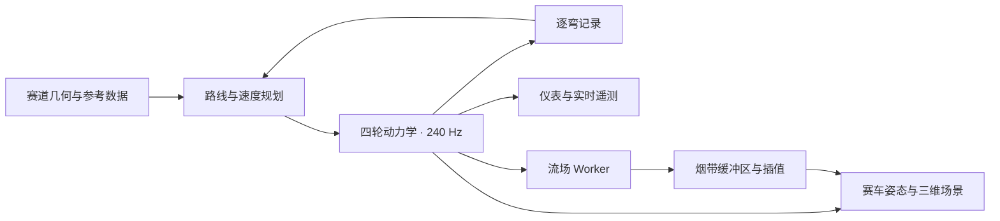

<div align="center">

# Formula one

**浏览器端方程式赛车动力学与遥测平台**

赛车检视 · 自主驾驶 · 走线寻优 · 空气动力学 · 实时遥测

[快速开始](#快速开始) · [功能与进度](#功能与进度) · [技术架构](#技术架构) · [项目结构](#项目结构) · [开发与验证](#开发与验证)

</div>

## 模型、开放数据与第三方署名

| 资源 | 作者与来源 | 项目用途及许可 |
| --- | --- | --- |
| **2026 Redbull RB22** | Dave Love（Tyler_Dave），[Sketchfab 原作](https://sketchfab.com/3d-models/2026-redbull-rb22-0a3d24a58e0549d591a5a48c22eec383) · [AgentiLoop/F1 上游版本](https://github.com/AgentiLoop/F1) | [CC BY 4.0](https://creativecommons.org/licenses/by/4.0/)。上游调整了金色紧固件贴图。Formula one 保留原涂装，烘焙模型变换，按 1.90 m 参考宽度缩放，并绑定车轮、主动翼与悬架。[修改与署名记录](data/models/rb22/UPSTREAM-CREDITS.md) · [模型清单](public/models/manifest.json) |
| 24 站平面布局 | Tomislav Bacinger，[f1-circuits](https://github.com/bacinger/f1-circuits) | 经纬度中心线用于生成缩略图、三维路带和发车格。[MIT](data/tracks/layouts/LICENSE-layout.md) |
| 24 站维修区道路 | © OpenStreetMap contributors · [Spa 原始道路](https://www.openstreetmap.org/way/323851541) · [各站道路数据](data/tracks/pit-lanes/) | 按各赛道独立道路铺设入口、限速段、车位、出口与并线段。[ODbL 1.0](https://www.openstreetmap.org/copyright) |
| 弯号、计时线与直道区 | [F1 Sensor](https://github.com/Nicxe/f1_sensor) · [MultiViewer 地图](https://api.multiviewer.app/api/v1/circuits) · FIA 分站赛事图 | 配准起终点、弯道、分段与直道激活位置。[MIT 署名](data/tracks/annotations/LICENSE) · [地图来源及配准结果](src/tracks/circuits/) |
| 地形与高程 | [Mapzen Terrain Tiles](https://registry.opendata.aws/terrain-tiles/) · [Open Topo Data / EU-DEM](https://www.opentopodata.org/datasets/eudem/) | Mapzen 瓦片生成其余 23 站的纵坡；Spa 另存有 EU-DEM 25 m 采样。地形数据按地区保留原提供方署名。[Mapzen 数据提供方与使用条件](https://github.com/tilezen/joerd/blob/master/docs/attribution.md) |
| 翼面风洞压力 | Ladson、Hill 与 Johnson，NASA TM 100526 | NACA 0012 双面压力测点用于翼面 Cp 配色与吸力面烟流速度参考。[实验数据与验证说明](https://tmbwg.github.io/turbmodels/naca0012_val.html) |
| 比赛遥测 | [OpenF1](https://openf1.org/)，2024 年比利时大奖赛 | 佩雷兹第 44 圈用于配准路线、速度与 Raidillon 高差；20 位车手的 723 个绿旗有效圈用于节奏对照。[本地基准数据](data/tracks/spa/race-pace/benchmark.json) |
| 车辆动力学参考 | Juan Manzanero / Fastest-lap · TUM Institute of Automotive Technology | 历史 F1 拟合参数、通用赛车模型和轨迹优化配置。[Fastest-lap · MIT](data/vehicle-dynamics/fastest-lap_LICENSE) · [Open-Car-Dynamics · Apache-2.0](data/vehicle-dynamics/TUM_OCD_LICENSE) · [轨迹优化 · LGPL-3.0](data/vehicle-dynamics/TUM_trajectory_LICENSE) |

**赛事与技术文献**　FIA 赛道清单、分站赛事图、Spa 官方地图和赛事指南用于定位路宽、高程锚点、主动翼区间及刹车距离牌。Dallara F308 手册用于动力学查阅，开放再分发许可尚未核实。[逐项来源与赛道定位](docs/sources.md) · [动力学参考文献](docs/vehicle-dynamics.md)

**开源软件**

| 用途 | 项目与许可 |
| --- | --- |
| 页面与三维渲染 | React、React DOM、Three.js（MIT） |
| 开发与构建 | Vite、DefinitelyTyped 类型定义（MIT）；TypeScript（Apache-2.0） |
| 模型处理与校验 | glTF Transform、meshoptimizer（MIT）；Khronos glTF Validator（Apache-2.0） |
| 赛道与贴图处理 | NumPy、SciPy（BSD-3-Clause）；Pillow（HPND） |

前端依赖的锁定版本见 [package-lock.json](package-lock.json)，数据处理环境见 [Python 依赖清单](scripts/requirements.txt)。Formula one 用于个人学习与非商业演示，项目自身代码尚未指定开源许可证。

## 🏎️ 项目概览

Formula one 将赛车模型、赛道、驾驶策略和遥测放在同一个三维场景中。以 RB22 为车辆载体，围绕四轮动力学、连续弯走线选择与空力可视化构建可交互的驾驶研究环境。

界面采用白色与 Papaya 橙。顶栏集中赛道、视角与发车控制；底栏按能源与轮胎、驾驶与空力、视图辅助、圈速遥测分区。小地图、宽幅遥测和圆形码表组成底部 HUD，遥测与控制栏可分别收起。

<a id="快速开始"></a>
## ⚡ 快速开始

**环境：** Node.js `^20.19.0` 或 `>=22.12.0`，支持 WebGL 2 的浏览器。

```sh
git clone https://github.com/MichaelJLx/F1Lab_VibeCoding.git
cd F1Lab_VibeCoding
npm ci
npm run dev
```

打开终端显示的本地地址，默认 `http://127.0.0.1:5173`。首屏显示 24 站赛道目录；点击卡片进入赛道，车辆从维修区待发。在顶栏设置飞驰圈数并点击 **发车**，比赛可暂停、继续或重置。再次点击赛道名称即可切换赛道。

选定赛道后才加载约 15 MB 的赛车模型及该站数据。首次进入、切换赛道和重置赛车均使用相同的待发车镜头，顶栏同步选中车尾视角。中央实时遥测默认收起，底部控制栏默认展开。生产构建使用 `npm run build`，产物位于 `dist/`。

<a id="功能与进度"></a>
## 🧭 功能与进度

| 模块 | 当前能力 |
| --- | --- |
| **赛道浏览** | 24 站目录、独立维修区与完整跑圈；各站共用四轮动力学、ERS、轮胎与主动翼规则 |
| **驾驶流程** | 维修区出站、按赛道正赛圈数上限设置有效飞驰圈与进站；四轮完全越界后自动复位，本圈作废且不占有效圈数 |
| **走线规划** | 全赛道按弯道与连续弯分组，联合比较入弯位置、弯心时机与出弯走线，以整组通过时间筛选 |
| **跨圈调整** | 保留各组历史安全最快策略，与小步探索逐项比较；失误后回退并缩小探索步长；主线显示当前预测路线，备选线显示实际评估的其他候选，两个开关只影响显示 |
| **车辆动力学** | 四轮载荷转移、独立悬架、滑移与横摆、循迹刹车、八速传动及主动翼联动 |
| **轮胎与悬挂** | 单轮抱死平斑随胎面旋转、摩擦白烟、四轮独立行程与连杆联动；底板接地才产生带反弹拖尾的火花 |
| **能源与轮胎** | 两个消耗开关默认关闭，保持满电与满抓地力；仅有效飞驰圈可部署 ERS 和开启直道模式，其余圈程锁定基础模式，开启消耗时仍可制动回收 |
| **空力展示** | 上游烟流、车身绕流、底板通道与尾流；独立 Cp 车身着色，关闭后恢复涂装，四轮保持原材质 |
| **实时遥测** | 最近 400 m 的车速／踏板、气动、底盘曲线；上一飞驰圈同位置对比、最快圈与差距、分段配色及理论最快圈 |
| **车内仪表** | 挡位、车速、圈速差、ERS、制动平衡、空力模式、四轮温度／胎压及实体 LED 换挡提示 |
| **尾部警示灯** | 关闭 ERS 消耗时持续展示闪烁（含待发车与暂停检视）；开启后维修区限速以 2 Hz 闪烁，实际回收与低电量警示以 4 Hz 闪烁，正常部署时熄灭；工况频闪使用仿真时间，展示闪烁使用独立时钟，LED 与辉光同步瞬时亮灭 |
| **观看与检视** | 头盔、车载、车尾、俯瞰、自由及赛道转播；部件标注、结构视图、车轮拆解与指定弯段回放 |

赛道布局、维修区道路与赛事图的来源见 [素材与赛道来源](docs/sources.md)。

### 空气动力学

车辆受力模型根据车速、翼面开度、离地间隙与姿态计算下压力和阻力。烟流采用近似速度场及部件边界约束，翼面 Cp 以公开 NACA 0012 压力测点为参考。

- **流场计算：** Web Worker 推演完整路径，平滑处理部件绕流、翼尖涡流与扩散器尾流。
- **连续显示：** 平行传输标架生成烟带，GPU 复用缓冲区，对路径、流速和行程坐标同步插值；加载时预热完整流线。
- **车底约束：** 从模型生成下表面高度场，将车底纵向烟流限制在底板宽度及离地间隙内，沿中央木板两侧进入扩散器。
- **空力读数：** 前后轴分力及占比、阻力、L/D、主动翼模式和底板中段相对来流速度探针。

### 遥测与交互

| 区域 | 内容 |
| --- | --- |
| 顶栏 | 赛道目录、分段式视角切换、飞驰圈数、播放／暂停与重置 |
| 底部 HUD | 赛道小地图、可独立收起的宽幅遥测、圆形车速／油门／刹车码表 |
| 四区底栏 | ERS 与轮胎开关、四轮俯视状态、驾驶节奏、空力与视图辅助、S1／S2／S3 |
| 气动载荷 | 模式徽章、轴荷分配、阻力与效率标尺、流速及 Cp 色阶 |

遥测距离刻度使用独立 HTML 标尺，避免随波形缩放变形。窄屏下 HUD 分行排列，车载与头盔视角降低遥测透明度，控制栏独立预留画布空间。

四轮完全离开沥青及路肩后，车辆会短暂停顿并在前方中心线复位，保留电量、胎温与累计磨损，清除抱死平斑，随后平滑回到当前走线。本圈计时与分段均标为「无效圈」，不进入圈速榜；重新通过起终点后开始新的有效飞驰圈。走线贴合路面上方 3 cm，备选线在飞驰圈方案就绪后显示，显示开关不改变驾驶决策。

<a id="技术架构"></a>
## 🛠️ 技术架构

| 层级 | 技术与职责 |
| --- | --- |
| 界面 | React 19、TypeScript、CSS、SVG；控制台、圆形仪表、遥测与状态图 |
| 三维 | Three.js、WebGL 2、GLSL；赛车装配、材质、镜头、烟流及压力着色 |
| 仿真 | TypeScript；以 1/240 s 固定步长推进车辆动力学 |
| 后台计算 | Web Workers；下一圈路线规划与气流路径求解 |
| 本地记录 | localStorage；逐弯成绩、侧滑位置与最近 60 圈计时历史 |
| 构建与数据 | Vite 7、Node.js、Python；模型处理、地形重建与参考数据生成 |



相邻弯段的走线策略连续过渡。跨圈驾驶学习只对持续失误施加速度限制，瞬间侧滑仍由实时车辆控制处理；驾驶模型版本变更时重新学习走线与限制，保留历史圈速。

路线规划、车辆受力和可视化分别组织。`Cruise` 推进驾驶与计时，`Inspector` 管理场景和赛车装配，`CircuitSession` 统一拥有并释放赛道、走线和驾驶规划线程，`TrackSurface` 独立提供路面、路肩和维修区的接地查询。`CruiseSnapshot` 经 `TelemetryStore` 推送给局部读数组件，外层界面只响应比赛阶段等离散变化。隐藏的行车线延迟更新网格，收起遥测后保留历史但停止绘制波形；规划线程只回传驾驶方案，不再生成主线程会重复构建的网格。流场关闭时隐藏绘制并停止常规求解，缓冲区保留供再次开启使用。

<a id="项目结构"></a>
## 📁 项目结构

以下按当前工作区实际文件展开，包含源码、全部 24 站数据、脚本、测试、参考资料及交付目录。依赖、构建产物、Git 内部文件和历史检查缓存仅列目录；系统隐藏文件与 Python 缓存不列出。标注「未纳入 Git」的本地文件不会随仓库克隆下载。

```text
F1Lab/
├── .gitignore  # 本地依赖、缓存和资料忽略规则
├── README.md  # 项目入口、署名、结构与任务状态
├── index.html  # 网页挂载入口
├── package.json  # 依赖与开发、构建、校验命令
├── package-lock.json  # Node.js 依赖锁定版本
├── tsconfig.json  # TypeScript 编译配置
├── vite.config.ts  # 开发服务与生产构建配置
├── src/  # 应用源码
│   ├── camera/  # 镜头控制
│   │   └── FreeCamera.ts  # 自由镜头与键盘移动
│   ├── model/  # 赛车装配、材质、气流与车辆视觉效果
│   │   ├── ActiveWings.ts  # 主动翼面拆分与开度联动
│   │   ├── Airflow.ts  # 流场缓冲区、着色器与 Worker 通信
│   │   ├── FlowBoundary.ts  # 车辆部件边界与绕流约束
│   │   ├── FlowClearance.ts  # 底板下表面高度与通道间隙
│   │   ├── FlowLayout.ts  # 流线分组与发射源布局
│   │   ├── FlowProtocol.ts  # 流场线程消息与数据类型
│   │   ├── FlowSolver.ts  # 气流积分、绕流、涡流与尾迹
│   │   ├── Inspector.ts  # 场景装配、镜头重置、车辆表现与帧调度
│   │   ├── MirrorGlare.ts  # 后视镜灯光与眩光
│   │   ├── PressureMap.ts  # 车身 Cp 材质与涂装恢复
│   │   ├── RearLight.ts  # 尾灯工况优先级、展示闪烁与方波频闪
│   │   ├── RibbonFrame.ts  # 流带平行传输标架
│   │   ├── SkidSparks.ts  # 触底火花池、拖尾与反弹
│   │   ├── SuspensionLinks.ts  # 四轮悬架连杆几何联动
│   │   ├── TyreSmoke.ts  # 轮胎打滑白烟粒子池
│   │   ├── TyreView.ts  # 胎面磨损、平斑与温度外观
│   │   ├── WheelEffects.ts  # 车轮接触阴影与运动残影
│   │   ├── WingPressure.ts  # 翼面压力参考与插值
│   │   ├── flap-ranges.json  # 活动翼面三角片区间
│   │   ├── flow.worker.ts  # 流场后台求解入口
│   │   ├── rb22-plan-view.json  # 车辆俯视轮廓数据
│   │   ├── suspension-rig.json  # 悬架连杆与底板探针
│   │   ├── wheel-rig.json  # 四轮中心、轴向与半径
│   │   └── wing-pressure.json  # 翼面 Cp 参考数据
│   ├── motion/  # 驾驶、车辆受力、能源与计时
│   │   ├── ActiveAero.ts  # 直道模式权限与翼面开度
│   │   ├── AeroPlatform.ts  # 气动载荷、离地间隙与地面效应
│   │   ├── Cruise.ts  # 驾驶状态、速度规划、越界复位、计时与快照
│   │   ├── DriverMemory.ts  # 按赛道保存驾驶记录与圈史
│   │   ├── Gearbox.ts  # 挡位、驱动功率、ERS 部署与回收
│   │   ├── LapLearning.ts  # 历史最优策略与跨圈探索回退
│   │   ├── LateralDynamics.ts  # 滑移、横摆与轮胎横向力
│   │   ├── Suspension.ts  # 四轮弹簧阻尼、载荷转移与车身姿态
│   │   ├── Tyre.ts  # 胎温、胎压、磨损与抱死平斑
│   │   └── lap.worker.ts  # 下一圈驾驶方案后台规划
│   ├── optimizer/  # 走线优化与显示
│   │   └── RacingLine.ts  # 行车线偏移、贴地网格与速度配色
│   ├── tracks/  # 所有赛道共用的数据与运行引擎
│   │   ├── circuits/  # 24 个独立完整赛道文件，使用同一 Schema
│   │   │   ├── austin.json
│   │   │   ├── bahrain.json
│   │   │   ├── baku.json
│   │   │   ├── barcelona.json
│   │   │   ├── budapest.json
│   │   │   ├── jeddah.json
│   │   │   ├── las-vegas.json
│   │   │   ├── lusail.json
│   │   │   ├── madrid.json
│   │   │   ├── melbourne.json
│   │   │   ├── mexico-city.json
│   │   │   ├── miami.json
│   │   │   ├── monaco.json
│   │   │   ├── montreal.json
│   │   │   ├── monza.json
│   │   │   ├── sao-paulo.json
│   │   │   ├── shanghai.json
│   │   │   ├── silverstone.json
│   │   │   ├── singapore.json
│   │   │   ├── spa.json
│   │   │   ├── spielberg.json
│   │   │   ├── suzuka.json
│   │   │   ├── yas-marina.json
│   │   │   └── zandvoort.json
│   │   ├── BrakingBoards.ts  # 弯号、刹车距离、主动翼与限速提示牌
│   │   ├── CircuitData.ts  # 统一赛道数据接口
│   │   ├── CircuitLoader.ts  # 浏览器与 Worker 按需导入
│   │   ├── CircuitRegistry.ts  # 测试及离线工具统一数据索引
│   │   ├── CircuitSchema.ts  # 数据结构校验
│   │   ├── CircuitSession.ts  # 单赛道资源、驾驶与规划线程生命周期
│   │   ├── CircuitTrack.ts  # 路面、路肩、格线与 s/d 坐标转换
│   │   ├── DrivingProfile.ts  # 弯组、驾驶配置与参考走线
│   │   ├── PitLane.ts  # 维修区路径、并线、限速段、车位与围栏
│   │   ├── TrackSurface.ts  # 地表高度、法线、材质与空间索引
│   │   └── catalog.json  # 24 站目录、选择卡片与注册信息
│   ├── ui/  # 界面组件与遥测数据展示
│   │   ├── AeroTelemetry.tsx  # 下压力、阻力、效率与气流标尺
│   │   ├── Brand.tsx  # 主界面与选择页共享品牌字标
│   │   ├── BroadcastDial.tsx  # 圆形 SVG 车速、踏板与挡位仪表
│   │   ├── CircuitBroadcast.tsx  # 赛道小地图与转播 HUD
│   │   ├── Controls.tsx  # 开关、分段选择器与播放图标
│   │   ├── CornerReview.tsx  # 弯段走线比较与回放
│   │   ├── LapCount.tsx  # 飞驰圈数设置
│   │   ├── LiveTelemetry.tsx  # 局部订阅的能源、轮胎与计时读数
│   │   ├── SectorHistory.tsx  # 圈速榜、分段与理论最快圈
│   │   ├── TelemetryPlot.tsx  # 最近 400 m 多通道曲线
│   │   ├── TelemetryStore.ts  # 遥测订阅与界面更新分流
│   │   ├── TrackMapLayout.ts  # 小地图弯号布局与避让
│   │   ├── TrackPicker.tsx  # 单层顶栏、居中赛道目录与切换弹窗
│   │   └── VehicleStatus.tsx  # 四轮磨损与胎压俯视状态图
│   ├── main.tsx  # React 入口、赛道选择与比赛控制
│   └── style.css  # 全局主题、响应式布局与 HUD 样式
├── public/  # 浏览器直接访问的静态资源
│   ├── audio/
│   └── models/  # 运行时赛车模型与灯光贴图
│       ├── manifest.json
│       ├── rb22-led-mask.png
│       ├── rb22-led-optics.png
│       └── rb22.glb
├── data/  # 原始参考资料、开放数据与许可证
│   ├── models/
│   │   └── rb22/  # 原始赛车模型及作者署名
│   │       ├── UPSTREAM-CREDITS.md
│   │       ├── rb22-community.glb
│   │       └── sketchfab-metadata.json
│   ├── tracks/  # 赛道来源与参考采样，区别于运行时 circuits 数据
│   │   ├── annotations/  # 赛事地图注记、弯号与配准修正
│   │   │   ├── LICENSE
│   │   │   ├── ae-2009.json
│   │   │   ├── at-1969.json
│   │   │   ├── au-1953.json
│   │   │   ├── az-2016.json
│   │   │   ├── bh-2002.json
│   │   │   ├── br-1940.json
│   │   │   ├── ca-1978.json
│   │   │   ├── catalog.json
│   │   │   ├── cn-2004.json
│   │   │   ├── es-1991.json
│   │   │   ├── es-2026.json
│   │   │   ├── gb-1948.json
│   │   │   ├── hu-1986.json
│   │   │   ├── it-1922.json
│   │   │   ├── jp-1962.json
│   │   │   ├── mc-1929.json
│   │   │   ├── mx-1962.json
│   │   │   ├── nl-1948.json
│   │   │   ├── qa-2004.json
│   │   │   ├── sa-2021.json
│   │   │   ├── sg-2008.json
│   │   │   ├── station-overrides.json
│   │   │   ├── us-2012.json
│   │   │   ├── us-2022.json
│   │   │   └── us-2023.json
│   │   ├── layouts/  # 24 站平面布局来源
│   │   │   ├── LICENSE-layout.md
│   │   │   └── f1-circuits.geojson
│   │   ├── pit-lanes/  # 各站维修区道路来源
│   │   │   ├── ae-2009-map.json
│   │   │   ├── at-1969-map.json
│   │   │   ├── au-1953-map.json
│   │   │   ├── az-2016-map.json
│   │   │   ├── bh-2002-map.json
│   │   │   ├── br-1940-map.json
│   │   │   ├── ca-1978-map.json
│   │   │   ├── cn-2004-map.json
│   │   │   ├── es-1991-map.json
│   │   │   ├── es-2026-map.json
│   │   │   ├── gb-1948-map.json
│   │   │   ├── hu-1986-map.json
│   │   │   ├── it-1922-map.json
│   │   │   ├── jp-1962-map.json
│   │   │   ├── mc-1929-map.json
│   │   │   ├── mx-1962-map.json
│   │   │   ├── nl-1948-map.json
│   │   │   ├── qa-2004-map.json
│   │   │   ├── sa-2021-map.json
│   │   │   ├── sg-2008-map.json
│   │   │   ├── us-2012-map.json
│   │   │   ├── us-2022-map.json
│   │   │   └── us-2023-map.json
│   │   ├── spa/  # Spa 历史精修参考资料
│   │   │   ├── flying/  # 参考飞驰圈遥测
│   │   │   │   ├── car_data.json
│   │   │   │   ├── laps.json
│   │   │   │   └── location.json
│   │   │   ├── race-pace/  # 比赛节奏参考集
│   │   │   │   ├── benchmark.json
│   │   │   │   ├── laps.json
│   │   │   │   ├── pit.json
│   │   │   │   └── race_control.json
│   │   │   ├── telemetry/  # 路线配准遥测与来源
│   │   │   │   ├── car_data.json
│   │   │   │   ├── lap.json
│   │   │   │   ├── location.json
│   │   │   │   └── source.json
│   │   │   ├── FIA-2026-Spa-zones.pdf  # 本地参考 PDF，未纳入 Git
│   │   │   ├── LICENSE-layout.md
│   │   │   ├── Spa官方地图_2026.pdf  # 本地参考 PDF，未纳入 Git
│   │   │   ├── be-1925.geojson
│   │   │   ├── elevation-anchors.json
│   │   │   ├── eudem25m.json
│   │   │   └── raidillon-profile.json
│   │   └── terrain/  # 地形高程与 FIA 赛道资料
│   │       ├── FIA-2023-circuits.pdf  # 本地参考 PDF，未纳入 Git
│   │       ├── FIA-2026-circuits.pdf  # 本地参考 PDF，未纳入 Git
│   │       └── terrain.json
│   └── vehicle-dynamics/  # 公开动力学参考与许可证
│       ├── Dallara_F308_制造商车主手册.pdf  # 本地参考 PDF，未纳入 Git
│       ├── TUM_OCD_LICENSE
│       ├── TUM_OCD_generic_double_track_MF52.json
│       ├── TUM_racecar.ini
│       ├── TUM_trajectory_LICENSE
│       ├── fastest-lap_LICENSE
│       ├── fastest-lap_mercedes-2020-catalunya.xml
│       └── sources.json
├── scripts/  # 可复用的数据和模型处理工具
│   ├── model/  # 模型整理与绑定数据生成
│   │   ├── build-plan-view.mjs
│   │   ├── build-suspension-rig.mjs
│   │   ├── build-wheel-rig.mjs
│   │   ├── build-wing-rig.py
│   │   └── prepare-model.mjs
│   ├── tracks/  # 赛道构建、校验与来源抓取
│   │   ├── build-circuits.mjs  # 校验标准赛道，生成目录与加载索引
│   │   ├── build-pace-benchmark.py
│   │   ├── fetch-circuit-terrain.py
│   │   ├── fetch-markings.py
│   │   ├── fetch-pit-lanes.py
│   │   └── fetch-spa-elevation.py
│   └── requirements.txt  # Python 数据处理依赖
├── tests/  # 基础回归及单独运行的整圈检查
│   ├── architecture.test.mjs
│   ├── architecture.ts
│   ├── bus-stop.ts
│   ├── circuits.ts
│   ├── driving.test.mjs
│   ├── driving.ts
│   ├── learning.test.mjs
│   ├── learning.ts
│   ├── model.test.mjs
│   ├── presentation.test.mjs
│   ├── presentation.ts
│   ├── reference-lap.ts
│   ├── run-circuits.mjs
│   ├── run-reference-lap.mjs
│   ├── tyre-effects.test.mjs
│   ├── tyre-effects.ts
│   ├── visualization.test.mjs
│   └── visualization.ts
├── docs/  # 来源与技术参考说明
│   ├── images/
│   ├── sources.md
│   └── vehicle-dynamics.md
├── process/  # 进行中任务过程目录，当前为空
├── outputs/  # 已交付成果
│   └── 2026-11-23_01_风洞参考可视化/  # 历史风洞可视化交付
│       └── 高速压力与烟流.jpg
├── F1-2026-Aero-Simulator-Prompt.md  # 本地原始需求资料，未纳入 Git
├── artifacts/  # 历史检查产物（本地目录，未纳入 Git）
├── dist/  # 生产构建产物（本地生成，未纳入 Git）
├── node_modules/  # 安装依赖（本地生成，未纳入 Git）
└── .git/  # Git 历史与对象（省略内部文件）
```

`data/` 保留原始来源及许可证，`src/tracks/circuits/` 是运行时赛道数据的唯一入口。全部赛道使用同一构造和运行管线，Spa 的局部精修保存在可选 `reference` 字段中。

中心线使用米制 Y 向上坐标，`s` 是闭合主赛道里程。每站文件包含高程、左右路宽、路肩断面、维修区路径与车位、弯号及连续弯组、分段计时点和主动翼区间。维修区 `points` 为接地后的驾驶中心线，`surfacePoints` 保留铺路中心线，两者共享赛道局部坐标。两条线分别用于行驶与接缝网格，避免反复贴地重建导致接缝漂移。

<a id="开发与验证"></a>
## 🧪 开发与验证

| 命令 | 用途 |
| --- | --- |
| `npm run dev` | 启动本地开发服务 |
| `npm run typecheck` | TypeScript 类型检查 |
| `npm run build` | 类型检查与生产构建 |
| `npm test` | 走线连续性、驾驶学习、模型完整性、流场边界、Cp 材质与 ERS 回收回归 |
| `npm run tracks:check` | 校验 24 站 Schema 与生成索引的一致性 |
| `npm run tracks:build` | 校验独立赛道文件，生成目录与加载索引 |
| `npm run test:reference` | 手动运行参考赛道整圈检查 |
| `npm run test:circuits` | 手动运行全赛道进出站与跑圈检查 |

日常修改执行类型检查、构建和基础测试即可。整圈测试单独保留，按需手动运行，不纳入基础检查。

<details>
<summary><strong>数据与模型构建管线</strong></summary>


`npm run dev` 和 `npm run build` 只消费已提交的生成数据。需要重建数据时，先安装 Python 依赖：

```sh
python3 -m pip install -r scripts/requirements.txt
```

赛道修改直接写入 `src/tracks/circuits/<circuitId>.json`，再运行 `npm run tracks:build`。也可导入外部整理完成的标准数据：

```sh
npm run tracks:build -- --import path/to/circuit.json
npm run tracks:check
```

导入文件必须符合 `CircuitData`，并匹配 `catalog.json` 中注册的 ID 与文件名。构建会检查闭合里程采样、维修区路径、弯组覆盖、分段与直道区；不在运行时做格式转换或起终点补丁。原始下载资料继续留在 `data/tracks/`，地形、地图注记和维修区道路抓取脚本继续用于更新来源。

```text
scripts/tracks/build-circuits.mjs       → catalog.json、CircuitLoader.ts、CircuitRegistry.ts
scripts/tracks/fetch-spa-elevation.py  → data/tracks/spa/eudem25m.json
scripts/tracks/fetch-circuit-terrain.py → data/tracks/terrain/terrain.json
scripts/tracks/fetch-markings.py       → data/tracks/annotations/
scripts/tracks/fetch-pit-lanes.py      → data/tracks/pit-lanes/
scripts/tracks/build-pace-benchmark.py → data/tracks/spa/race-pace/benchmark.json
scripts/model/prepare-model.mjs       → public/models/rb22.glb、manifest.json
scripts/model/build-plan-view.mjs     → src/model/rb22-plan-view.json
scripts/model/build-wheel-rig.mjs     → src/model/wheel-rig.json
scripts/model/build-suspension-rig.mjs → src/model/suspension-rig.json
scripts/model/build-wing-rig.py       → src/model/flap-ranges.json
```

更新原始赛车模型时，将新 GLB 放到 `data/models/rb22/rb22-community.glb`，再依次执行 `npm run model:build`、`npm run rig:build`、`node scripts/model/build-suspension-rig.mjs`（重建底板探针与悬架连杆）和 `python3 scripts/model/build-wing-rig.py`（重建翼面分片），最后运行 `node scripts/model/build-plan-view.mjs` 同步俯视状态图。

模型处理使用 glTF Transform、meshoptimizer 和 glTF Validator；赛道处理使用 Node.js 与 Python。

</details>

## 当前工作

| 任务标识 | 主题 | 状态 | 最近更新 | 当前成果 |
| --- | --- | --- | --- | --- |
| 2026-11-27_04_目录文档与推送 | 完整项目目录树、模块职责与当前改动发布 | 已完成 | 2026-11-27 | [项目结构](#项目结构) |
| 2026-11-27_03_选图页面布局 | 单层品牌顶栏、居中版心、响应式网格与列表末尾署名 | 已完成 | 2026-11-27 | [赛道选择](src/ui/TrackPicker.tsx) · [共享品牌](src/ui/Brand.tsx) |
| 2026-11-27_02_镜头选图与尾灯 | 镜头重置一致性、选图配色与能量尾灯；修复静态检视尾灯熄灭 | 已完成 | 2026-11-27 | [镜头与灯光接入](src/model/Inspector.ts) · [尾灯控制](src/model/RearLight.ts) · [基础回归](tests/presentation.ts) |
| 2026-11-27_01_赛道架构统一 | 24 站统一数据与引擎、首屏与小地图、性能解耦 | 已完成 | 2026-11-27 | [赛道引擎](src/tracks/CircuitTrack.ts) · [标准数据](src/tracks/circuits/) · [基础回归](tests/architecture.ts) |
| 2026-11-26_04_轮胎与悬挂 | 抱死平斑、摩擦烟雾、触底火花与独立悬挂 | 已完成 | 2026-11-27 | [轮胎](src/motion/Tyre.ts) · [悬挂](src/motion/Suspension.ts) |
| 2026-11-26_03_全赛道与车底流场 | 全赛道维修区、驾驶、车底流场与计时界面 | 已完成 | 2026-11-26 | [维修区](src/tracks/PitLane.ts) · [各站道路](src/tracks/circuits/) · [驾驶逻辑](src/motion/Cruise.ts) |
| 2026-11-26_01_驾驶异常排查 | 驾驶一致性检查 | 已完成 | 2026-11-26 | [驾驶逻辑](src/motion/Cruise.ts) · [专项回归](tests/driving.ts) · [整圈回归](tests/reference-lap.ts) |
| 2026-11-26_02_走线与无效圈 | 走线显示、越界复位与圈次权限 | 已完成 | 2026-11-26 | [走线显示](src/optimizer/RacingLine.ts) · [驾驶与计时](src/motion/Cruise.ts) · [专项回归](tests/driving.ts) |

## 作者

**Michael** · 项目设计与驾驶体验<br>
**OpenAI Codex** · 开发协作
