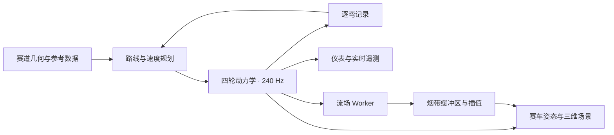

<div align="center">

# Formula one

**浏览器端方程式赛车动力学与遥测平台**

赛车检视 · 自主驾驶 · 走线寻优 · 空气动力学 · 实时遥测

[快速开始](#快速开始) · [功能与进度](#功能与进度) · [技术架构](#技术架构) · [项目结构](#项目结构) · [开发与验证](#开发与验证)

</div>

## 模型、开放数据与第三方署名

| 资源 | 作者与来源 | 项目用途及许可 |
| --- | --- | --- |
| **2026 Redbull RB22** | Dave Love（Tyler_Dave），[Sketchfab 原作](https://sketchfab.com/3d-models/2026-redbull-rb22-0a3d24a58e0549d591a5a48c22eec383) · [AgentiLoop/F1 上游版本](https://github.com/AgentiLoop/F1) | [CC BY 4.0](https://creativecommons.org/licenses/by/4.0/)。上游调整了金色紧固件贴图。Formula one 保留原涂装，烘焙模型变换，按 1.90 m 参考宽度缩放，并绑定车轮、主动翼与悬架。[修改与署名记录](vehicles/rb22/sources/UPSTREAM-CREDITS.md) · [模型清单](public/vehicles/rb22/manifest.json) |
| 24 站平面布局 | Tomislav Bacinger，[f1-circuits](https://github.com/bacinger/f1-circuits) | 经纬度中心线用于生成缩略图、三维路带和发车格。[MIT](references/circuits/layouts/LICENSE-layout.md) |
| 24 站维修区道路 | © OpenStreetMap contributors · [Spa 原始道路](https://www.openstreetmap.org/way/323851541) · [各站道路数据](circuits/) | 按各赛道独立道路铺设入口、限速段、车位、出口与并线段。[ODbL 1.0](https://www.openstreetmap.org/copyright) |
| 弯号、计时线与直道区 | [F1 Sensor](https://github.com/Nicxe/f1_sensor) · [MultiViewer 地图](https://api.multiviewer.app/api/v1/circuits) · FIA 分站赛事图 | 配准起终点、弯道、分段与直道激活位置。[MIT 署名](references/circuits/annotations/LICENSE) · [地图来源及配准结果](circuits/) |
| 地形与高程 | [Mapzen Terrain Tiles](https://registry.opendata.aws/terrain-tiles/) · [Open Topo Data / EU-DEM](https://www.opentopodata.org/datasets/eudem/) | Mapzen 瓦片生成其余 23 站的纵坡；Spa 另存有 EU-DEM 25 m 采样。地形数据按地区保留原提供方署名。[Mapzen 数据提供方与使用条件](https://github.com/tilezen/joerd/blob/master/docs/attribution.md) |
| 翼面风洞压力 | Ladson、Hill 与 Johnson，NASA TM 100526 | NACA 0012 双面压力测点用于翼面 Cp 配色与吸力面烟流速度参考。[实验数据与验证说明](https://tmbwg.github.io/turbmodels/naca0012_val.html) |
| 比赛遥测 | [OpenF1](https://openf1.org/)，逐站记录实际年份与场次 | 24 站归档参考圈、分段、车速与位置样本；保留 Spa 2024 年历史配准与节奏基准。[逐站资料](circuits/) · [年份与回退说明](docs/sources.md#全赛道资料归档) |
| 车辆动力学参考 | Juan Manzanero / Fastest-lap · TUM Institute of Automotive Technology | 历史 F1 拟合参数、通用赛车模型和轨迹优化配置。[Fastest-lap · MIT](references/vehicle-dynamics/fastest-lap_LICENSE) · [Open-Car-Dynamics · Apache-2.0](references/vehicle-dynamics/TUM_OCD_LICENSE) · [轨迹优化 · LGPL-3.0](references/vehicle-dynamics/TUM_trajectory_LICENSE) |

**赛事与技术文献**　FIA 赛道清单、分站赛事图、Spa 官方地图和赛事指南用于定位路宽、高程锚点、主动翼区间及刹车距离牌。Dallara F308 手册用于动力学查阅，开放再分发许可尚未核实。[逐项来源与赛道定位](docs/sources.md) · [动力学参考文献](docs/vehicle-dynamics.md)

**开源软件**

| 用途 | 项目与许可 |
| --- | --- |
| 页面与三维渲染 | React、React DOM、Three.js（MIT） |
| 开发与构建 | Vite、DefinitelyTyped 类型定义（MIT）；TypeScript（Apache-2.0） |
| 模型处理与校验 | glTF Transform、meshoptimizer（MIT）；Khronos glTF Validator（Apache-2.0） |
| 赛道与贴图处理 | NumPy、SciPy（BSD-3-Clause）；Pillow（HPND） |

前端依赖的锁定版本见 [package-lock.json](package-lock.json)，数据处理环境见 [Python 依赖清单](scripts/requirements.txt)。Formula one 用于个人学习与非商业演示，项目自身代码尚未指定开源许可证。

## 🏎️ 项目概览

Formula one 将赛车模型、赛道、驾驶策略和遥测放在同一个三维场景中。以 RB22 为车辆载体，围绕四轮动力学、连续弯走线选择与空力可视化构建可交互的驾驶研究环境。

界面采用白色与 Papaya 橙。顶栏集中赛道、视角与发车控制；底栏按能源与轮胎、驾驶与空力、视图辅助、圈速遥测分区。小地图、宽幅遥测和圆形码表组成底部 HUD，遥测与控制栏可分别收起。

<a id="快速开始"></a>
## ⚡ 快速开始

**环境：** Node.js `^20.19.0` 或 `>=22.12.0`，支持 WebGL 2 的浏览器。

```sh
git clone https://github.com/MichaelJLx/F1Lab_VibeCoding.git
cd F1Lab_VibeCoding
npm ci
npm run dev
```

打开终端显示的本地地址，默认 `http://127.0.0.1:5173`。首屏显示 24 站赛道目录；点击卡片进入赛道，车辆从维修区待发。在顶栏设置飞驰圈数并点击 **发车**，比赛可暂停、继续或重置。再次点击赛道名称即可切换赛道。

选定赛道后才加载约 15 MB 的赛车模型及该站数据。首次进入、切换赛道和重置赛车均使用相同的待发车镜头，顶栏同步选中车尾视角。中央实时遥测默认收起，底部控制栏默认展开。生产构建使用 `npm run build`，产物位于 `dist/`。

<a id="功能与进度"></a>
## 🧭 功能与进度

| 模块 | 当前能力 |
| --- | --- |
| **赛道浏览** | 24 站目录、独立维修区与完整跑圈；各站共用四轮动力学、ERS、轮胎与主动翼规则 |
| **驾驶流程** | 维修区出站、按赛道正赛圈数上限设置有效飞驰圈与进站；四轮完全越界后自动复位，本圈作废且不占有效圈数 |
| **走线规划** | 全赛道按弯道与连续弯分组，联合比较入弯位置、弯心时机与出弯走线，以整组通过时间筛选 |
| **跨圈调整** | 保留各组历史安全最快策略，与小步探索逐项比较；失误后回退并缩小探索步长；最佳走线显示当前预测路线，开关只影响显示，后台保留完整候选策略比较 |
| **车辆动力学** | 四轮载荷转移、独立悬架、滑移与横摆、循迹刹车、八速传动及主动翼联动 |
| **轮胎与悬挂** | 单轮抱死平斑随胎面旋转、摩擦白烟、四轮独立行程与连杆联动；底板接地才产生带反弹拖尾的火花 |
| **能源与轮胎** | 两个消耗开关默认关闭，保持满电与满抓地力；仅有效飞驰圈可部署 ERS 和开启直道模式，其余圈程锁定基础模式，开启消耗时仍可制动回收 |
| **空力展示** | 上游烟流、车身绕流、底板通道与尾流；独立 Cp 车身着色，关闭后恢复涂装，四轮保持原材质 |
| **实时遥测** | 最近 400 m 的车速／踏板、气动、底盘曲线；上一飞驰圈同位置对比、最快圈与差距、分段配色及理论最快圈 |
| **车内仪表** | 20 Hz 实时车速、挡位、转速、圈时与差距、ERS 充放电、空力模式、四轮温度／胎压／磨损；实体 LED 随转速点亮，回放读取对应时刻数据 |
| **车辆警示灯** | 出场、回场、无效圈与维修区前后同步 2 Hz；开启 ERS 消耗的飞驰圈正常行驶熄灯，滑行回收仅尾灯 2 Hz、制动仅尾灯 4 Hz；关闭 ERS 消耗时保留尾灯展示闪烁。统一时钟、瞬时亮灭，灯珠发光强度提升至原来的 1.6 倍 |
| **观看与检视** | 头盔、车载、车尾、俯瞰、自由及赛道转播；结构视图、环绕、部件点选与指定弯段回放 |

赛道布局、维修区道路与赛事图的来源见 [素材与赛道来源](docs/sources.md)。

底栏提供 PSI／BAR／kPa 胎压单位切换、软／中性／硬胎配方切换和「换新胎」。配方同步影响驾驶规划、轮胎抓地力、磨损与侧壁色环；换胎恢复胎压并清除磨损和平斑，保留当前圈次、里程与车轮转动。视图辅助保留最佳走线、赛道提示牌、结构视图和环绕，底栏维持 100 px 高度。

### 空气动力学

空气流场与空力读数在首次进入及切换赛道时默认关闭。前翼左右双襟翼组件同步降低迎角；尾翼两片活动翼绕后部共同横轴整体收平，打开主翼上方通道。翼间连接件保持刚性随动，鼻锥与尾翼壳体作动杆沿安装点伸缩，开闭过渡为 300 ms。视图辅助按开关、画面、机位三行排列。

车辆受力模型根据车速、翼面开度、离地间隙与姿态计算下压力和阻力。烟流采用近似速度场及部件边界约束，翼面 Cp 以公开 NACA 0012 压力测点为参考。

- **流场计算：** 车身与活动翼使用实模预烘焙的 25 mm 距离场，轮胎边界随轮轴更新；Web Worker 以最高 8 Hz 推演完整路径，避免实时遍历整车三角面。
- **连续显示：** 平行传输标架生成烟带，GPU 复用缓冲区，对路径、流速和行程坐标同步插值。加载时预热完整流线，开关复用常驻缓冲区并快速渐显，关闭后停止持续求解；高斯羽化与连续噪声浓度扩散形成柔和烟束。
- **贴体绕流：** 使用实模边界引导烟流，不再叠加旧椭球排斥包络或强制外移入口；轮胎旁固定绕行侧并平滑曲率，避免边界修正造成折返。
- **车底约束：** 从模型生成下表面高度场，将车底纵向烟流限制在底板宽度及离地间隙内，沿中央木板两侧进入扩散器。底板采样补齐仅命中木板的断行，使用连续宽度边界，避免烟带逐顶点吸附栅格产生折痕。烟带采用错位入口、渐变宽度与连续浓度扩散，并随侧滑和车身横摆调整通道内的流向与流速。
- **空力读数：** 前后轴分力及占比、阻力、L/D、主动翼模式和底板中段相对来流速度探针。

### 遥测与交互

| 区域 | 内容 |
| --- | --- |
| 顶栏 | 赛道目录、分段式视角切换、飞驰圈数、播放／暂停与重置 |
| 底部 HUD | 赛道小地图、可独立收起的宽幅遥测、圆形车速／油门／刹车码表 |
| 四区底栏 | ERS 与轮胎开关、四轮俯视状态、驾驶节奏、空力与视图辅助、S1／S2／S3 |
| 气动载荷 | 模式徽章、轴荷分配、阻力与效率标尺、流速及 Cp 色阶 |

遥测距离刻度使用独立 HTML 标尺，避免随波形缩放变形。窄屏下 HUD 分行排列，车载与头盔视角降低遥测透明度，控制栏独立预留画布空间。

T-Cam 保留原模型材质与涂装，车载镜头从当前模型提取位置并隐藏自身支架。头盔机位使用 70° 垂直视场角和轻微边缘暗角，支持以下操作：

| 操作 | 头盔视角响应 |
| --- | --- |
| 按住鼠标左键拖动 | 平滑转头，机位保持在座舱眼位 |
| 松开鼠标 | 保持当前观察方向 |
| 双击画布 | 平滑回正 |
| 重新进入头盔视角／切换赛道 | 清除上次手动转头偏移 |

转头范围按当前座舱调校为左右约 55°、抬头 18°、低头 30°；侧转时收紧俯仰，总限位包含入弯自动转头。车型机位配置见 `vehicles/rb22/rig/cameras.json`，输入限位与阻尼见 `src/scene/camera/HelmetLook.ts`。

方向盘屏幕以 20 Hz 刷新遥测，顶部 ERS 电量条实时联动，原模型的静态 KERS 覆盖条已隐藏。下部五个旋钮使用哑光深色表面与独立紧凑刻度盘，保留功能标识及方向盘转动绑定；刻度纹理仅在加载时生成。

四轮完全离开沥青及路肩后，车辆会短暂停顿并在前方中心线复位，保留电量、胎温与累计磨损，清除抱死平斑，随后平滑回到当前走线。本圈计时与分段均标为「无效圈」，不进入圈速榜；重新通过起终点后开始新的有效飞驰圈。走线贴合路面上方 3 cm，显示开关不改变驾驶决策。

<a id="技术架构"></a>
## 🛠️ 技术架构

| 层级 | 技术与职责 |
| --- | --- |
| 界面 | React 19、TypeScript、CSS、SVG；控制台、圆形仪表、遥测与状态图 |
| 三维 | Three.js、WebGL 2、GLSL；赛车装配、材质、镜头、烟流及压力着色 |
| 仿真 | TypeScript；以 1/240 s 固定步长推进车辆动力学 |
| 后台计算 | Web Workers；下一圈路线规划与气流路径求解 |
| 本地记录 | localStorage；逐弯成绩、侧滑位置与最近 60 圈计时历史 |
| 构建与数据 | Vite 7、Node.js、Python；模型处理、地形重建与参考数据生成 |



相邻弯段的走线策略连续过渡。跨圈驾驶学习只对持续失误施加速度限制，瞬间侧滑仍由实时车辆控制处理；驾驶模型版本变更时重新学习走线与限制，保留历史圈速。

路线规划、车辆受力和可视化分别组织。`Cruise` 推进驾驶与计时，`Inspector` 管理场景和赛车装配，`CircuitSession` 统一拥有并释放赛道、走线和驾驶规划线程，`TrackSurface` 独立提供路面、路肩和维修区的接地查询。`CruiseSnapshot` 经 `TelemetryStore` 推送给局部读数组件，外层界面只响应比赛阶段等离散变化。隐藏的行车线延迟更新网格，收起遥测后保留历史但停止绘制波形；规划线程只回传驾驶方案，不再生成主线程会重复构建的网格。流场关闭时隐藏绘制并停止常规求解，缓冲区保留供再次开启使用。

<a id="项目结构"></a>
## 📁 项目结构

赛道资料按站归集，车型资源按车归集。下列目录列出工程文件与本地模型核验产物；安装依赖、构建输出和本地历史提示词由 Git 忽略。

```text
F1Lab/
├── circuits/  # 24 站运行数据与本站来源
│   ├── austin/
│   │   ├── sources/
│   │   │   ├── annotations/
│   │   │   │   ├── coordinate-map-2026.json
│   │   │   │   ├── fia-map-index.json
│   │   │   │   ├── map.json
│   │   │   │   ├── source.json  # 年份、来源与文件校验值
│   │   │   │   └── timing-markers.json
│   │   │   ├── elevation/
│   │   │   │   ├── dem-anchors.json
│   │   │   │   ├── source.json  # 年份、来源与文件校验值
│   │   │   │   └── terrain.json
│   │   │   ├── layout/
│   │   │   │   ├── centerline.geojson
│   │   │   │   ├── fia-2026-circuit-map.pdf
│   │   │   │   ├── official-facts-2026.json
│   │   │   │   └── source.json  # 年份、来源与文件校验值
│   │   │   ├── pit-lane/
│   │   │   │   ├── fia-2026-competition-visa.pdf
│   │   │   │   ├── fia-2026-event-notes.pdf
│   │   │   │   ├── fia-pit-index.json
│   │   │   │   ├── map.json
│   │   │   │   └── source.json  # 年份、来源与文件校验值
│   │   │   ├── sessions/
│   │   │   │   ├── 2026/
│   │   │   │   │   ├── car-data.json
│   │   │   │   │   ├── laps.json
│   │   │   │   │   ├── location.json
│   │   │   │   │   ├── pit.json
│   │   │   │   │   ├── reference-lap.json
│   │   │   │   │   └── session.json
│   │   │   │   └── source.json  # 年份、来源与文件校验值
│   │   │   └── source.json  # 年份、来源与文件校验值
│   │   └── circuit.json  # 本站唯一运行数据入口
│   ├── bahrain/
│   │   ├── sources/
│   │   │   ├── annotations/
│   │   │   │   ├── coordinate-map-2025.json
│   │   │   │   ├── fia-map-index.json
│   │   │   │   ├── map.json
│   │   │   │   ├── source.json  # 年份、来源与文件校验值
│   │   │   │   └── timing-markers.json
│   │   │   ├── elevation/
│   │   │   │   ├── dem-anchors.json
│   │   │   │   ├── source.json  # 年份、来源与文件校验值
│   │   │   │   └── terrain.json
│   │   │   ├── layout/
│   │   │   │   ├── centerline.geojson
│   │   │   │   ├── fia-2025-circuit-map-a3190afc.pdf
│   │   │   │   ├── fia-2025-circuit-map.pdf
│   │   │   │   ├── official-facts-2025.json
│   │   │   │   └── source.json  # 年份、来源与文件校验值
│   │   │   ├── pit-lane/
│   │   │   │   ├── fia-2025-event-notes-d2fc4a18.pdf
│   │   │   │   ├── fia-2025-event-notes.pdf
│   │   │   │   ├── fia-pit-index.json
│   │   │   │   ├── map.json
│   │   │   │   └── source.json  # 年份、来源与文件校验值
│   │   │   ├── sessions/
│   │   │   │   ├── 2025/
│   │   │   │   │   ├── car-data.json
│   │   │   │   │   ├── laps.json
│   │   │   │   │   ├── location.json
│   │   │   │   │   ├── pit.json
│   │   │   │   │   ├── reference-lap.json
│   │   │   │   │   └── session.json
│   │   │   │   └── source.json  # 年份、来源与文件校验值
│   │   │   └── source.json  # 年份、来源与文件校验值
│   │   └── circuit.json  # 本站唯一运行数据入口
│   ├── baku/
│   │   ├── sources/
│   │   │   ├── annotations/
│   │   │   │   ├── coordinate-map-2026.json
│   │   │   │   ├── fia-map-index.json
│   │   │   │   ├── map.json
│   │   │   │   ├── source.json  # 年份、来源与文件校验值
│   │   │   │   └── timing-markers.json
│   │   │   ├── elevation/
│   │   │   │   ├── dem-anchors.json
│   │   │   │   ├── source.json  # 年份、来源与文件校验值
│   │   │   │   └── terrain.json
│   │   │   ├── layout/
│   │   │   │   ├── centerline.geojson
│   │   │   │   ├── fia-2026-circuit-map.pdf
│   │   │   │   ├── official-facts-2026.json
│   │   │   │   └── source.json  # 年份、来源与文件校验值
│   │   │   ├── pit-lane/
│   │   │   │   ├── fia-2026-event-notes.pdf
│   │   │   │   ├── fia-pit-index.json
│   │   │   │   ├── map.json
│   │   │   │   └── source.json  # 年份、来源与文件校验值
│   │   │   ├── sessions/
│   │   │   │   ├── 2026/
│   │   │   │   │   ├── car-data.json
│   │   │   │   │   ├── laps.json
│   │   │   │   │   ├── location.json
│   │   │   │   │   ├── pit.json
│   │   │   │   │   ├── reference-lap.json
│   │   │   │   │   └── session.json
│   │   │   │   └── source.json  # 年份、来源与文件校验值
│   │   │   └── source.json  # 年份、来源与文件校验值
│   │   └── circuit.json  # 本站唯一运行数据入口
│   ├── barcelona/
│   │   ├── sources/
│   │   │   ├── annotations/
│   │   │   │   ├── coordinate-map-2026.json
│   │   │   │   ├── fia-map-index.json
│   │   │   │   ├── map.json
│   │   │   │   ├── source.json  # 年份、来源与文件校验值
│   │   │   │   └── timing-markers.json
│   │   │   ├── elevation/
│   │   │   │   ├── dem-anchors.json
│   │   │   │   ├── source.json  # 年份、来源与文件校验值
│   │   │   │   └── terrain.json
│   │   │   ├── layout/
│   │   │   │   ├── centerline.geojson
│   │   │   │   ├── fia-2026-circuit-map.pdf
│   │   │   │   ├── official-facts-2026.json
│   │   │   │   └── source.json  # 年份、来源与文件校验值
│   │   │   ├── pit-lane/
│   │   │   │   ├── fia-2026-competition-visa.pdf
│   │   │   │   ├── fia-2026-event-notes.pdf
│   │   │   │   ├── fia-pit-index.json
│   │   │   │   ├── map.json
│   │   │   │   └── source.json  # 年份、来源与文件校验值
│   │   │   ├── sessions/
│   │   │   │   ├── 2026/
│   │   │   │   │   ├── car-data.json
│   │   │   │   │   ├── laps.json
│   │   │   │   │   ├── location.json
│   │   │   │   │   ├── pit.json
│   │   │   │   │   ├── reference-lap.json
│   │   │   │   │   └── session.json
│   │   │   │   └── source.json  # 年份、来源与文件校验值
│   │   │   └── source.json  # 年份、来源与文件校验值
│   │   └── circuit.json  # 本站唯一运行数据入口
│   ├── budapest/
│   │   ├── sources/
│   │   │   ├── annotations/
│   │   │   │   ├── coordinate-map-2026.json
│   │   │   │   ├── fia-map-index.json
│   │   │   │   ├── map.json
│   │   │   │   ├── source.json  # 年份、来源与文件校验值
│   │   │   │   └── timing-markers.json
│   │   │   ├── elevation/
│   │   │   │   ├── dem-anchors.json
│   │   │   │   ├── source.json  # 年份、来源与文件校验值
│   │   │   │   └── terrain.json
│   │   │   ├── layout/
│   │   │   │   ├── centerline.geojson
│   │   │   │   ├── fia-2026-circuit-map.pdf
│   │   │   │   ├── official-facts-2026.json
│   │   │   │   └── source.json  # 年份、来源与文件校验值
│   │   │   ├── pit-lane/
│   │   │   │   ├── fia-2026-competition-visa.pdf
│   │   │   │   ├── fia-2026-event-notes.pdf
│   │   │   │   ├── fia-pit-index.json
│   │   │   │   ├── map.json
│   │   │   │   └── source.json  # 年份、来源与文件校验值
│   │   │   ├── sessions/
│   │   │   │   ├── 2026/
│   │   │   │   │   ├── car-data.json
│   │   │   │   │   ├── laps.json
│   │   │   │   │   ├── location.json
│   │   │   │   │   ├── pit.json
│   │   │   │   │   ├── reference-lap.json
│   │   │   │   │   └── session.json
│   │   │   │   └── source.json  # 年份、来源与文件校验值
│   │   │   └── source.json  # 年份、来源与文件校验值
│   │   └── circuit.json  # 本站唯一运行数据入口
│   ├── jeddah/
│   │   ├── sources/
│   │   │   ├── annotations/
│   │   │   │   ├── coordinate-map-2026.json
│   │   │   │   ├── fia-map-index.json
│   │   │   │   ├── map.json
│   │   │   │   ├── source.json  # 年份、来源与文件校验值
│   │   │   │   └── timing-markers.json
│   │   │   ├── elevation/
│   │   │   │   ├── dem-anchors.json
│   │   │   │   ├── source.json  # 年份、来源与文件校验值
│   │   │   │   └── terrain.json
│   │   │   ├── layout/
│   │   │   │   ├── centerline.geojson
│   │   │   │   ├── fia-2025-circuit-map.pdf
│   │   │   │   ├── official-facts-2025.json
│   │   │   │   └── source.json  # 年份、来源与文件校验值
│   │   │   ├── pit-lane/
│   │   │   │   ├── fia-2025-event-notes-v2.pdf
│   │   │   │   ├── fia-pit-index.json
│   │   │   │   ├── map.json
│   │   │   │   └── source.json  # 年份、来源与文件校验值
│   │   │   ├── sessions/
│   │   │   │   ├── 2025/
│   │   │   │   │   ├── car-data.json
│   │   │   │   │   ├── laps.json
│   │   │   │   │   ├── location.json
│   │   │   │   │   ├── pit.json
│   │   │   │   │   ├── reference-lap.json
│   │   │   │   │   └── session.json
│   │   │   │   └── source.json  # 年份、来源与文件校验值
│   │   │   └── source.json  # 年份、来源与文件校验值
│   │   └── circuit.json  # 本站唯一运行数据入口
│   ├── las-vegas/
│   │   ├── sources/
│   │   │   ├── annotations/
│   │   │   │   ├── coordinate-map-2026.json
│   │   │   │   ├── fia-map-index.json
│   │   │   │   ├── map.json
│   │   │   │   ├── source.json  # 年份、来源与文件校验值
│   │   │   │   ├── station-overrides.json
│   │   │   │   └── timing-markers.json
│   │   │   ├── elevation/
│   │   │   │   ├── dem-anchors.json
│   │   │   │   ├── source.json  # 年份、来源与文件校验值
│   │   │   │   └── terrain.json
│   │   │   ├── layout/
│   │   │   │   ├── centerline.geojson
│   │   │   │   ├── fia-2026-circuit-map.pdf
│   │   │   │   ├── official-facts-2026.json
│   │   │   │   └── source.json  # 年份、来源与文件校验值
│   │   │   ├── pit-lane/
│   │   │   │   ├── fia-2026-competition-visa.pdf
│   │   │   │   ├── fia-2026-event-notes.pdf
│   │   │   │   ├── fia-pit-index.json
│   │   │   │   ├── map.json
│   │   │   │   └── source.json  # 年份、来源与文件校验值
│   │   │   ├── sessions/
│   │   │   │   ├── 2026/
│   │   │   │   │   ├── car-data.json
│   │   │   │   │   ├── laps.json
│   │   │   │   │   ├── location.json
│   │   │   │   │   ├── pit.json
│   │   │   │   │   ├── reference-lap.json
│   │   │   │   │   └── session.json
│   │   │   │   └── source.json  # 年份、来源与文件校验值
│   │   │   └── source.json  # 年份、来源与文件校验值
│   │   └── circuit.json  # 本站唯一运行数据入口
│   ├── lusail/
│   │   ├── sources/
│   │   │   ├── annotations/
│   │   │   │   ├── coordinate-map-2026.json
│   │   │   │   ├── fia-map-index.json
│   │   │   │   ├── map.json
│   │   │   │   ├── source.json  # 年份、来源与文件校验值
│   │   │   │   └── timing-markers.json
│   │   │   ├── elevation/
│   │   │   │   ├── dem-anchors.json
│   │   │   │   ├── source.json  # 年份、来源与文件校验值
│   │   │   │   └── terrain.json
│   │   │   ├── layout/
│   │   │   │   ├── centerline.geojson
│   │   │   │   ├── fia-2026-circuit-map.pdf
│   │   │   │   ├── official-facts-2026.json
│   │   │   │   └── source.json  # 年份、来源与文件校验值
│   │   │   ├── pit-lane/
│   │   │   │   ├── fia-2026-competition-visa.pdf
│   │   │   │   ├── fia-2026-event-notes.pdf
│   │   │   │   ├── fia-pit-index.json
│   │   │   │   ├── map.json
│   │   │   │   └── source.json  # 年份、来源与文件校验值
│   │   │   ├── sessions/
│   │   │   │   ├── 2026/
│   │   │   │   │   ├── car-data.json
│   │   │   │   │   ├── laps.json
│   │   │   │   │   ├── location.json
│   │   │   │   │   ├── pit.json
│   │   │   │   │   ├── reference-lap.json
│   │   │   │   │   └── session.json
│   │   │   │   └── source.json  # 年份、来源与文件校验值
│   │   │   └── source.json  # 年份、来源与文件校验值
│   │   └── circuit.json  # 本站唯一运行数据入口
│   ├── madrid/
│   │   ├── sources/
│   │   │   ├── annotations/
│   │   │   │   ├── fia-map-index.json
│   │   │   │   ├── map.json
│   │   │   │   └── source.json  # 年份、来源与文件校验值
│   │   │   ├── elevation/
│   │   │   │   ├── dem-anchors.json
│   │   │   │   ├── source.json  # 年份、来源与文件校验值
│   │   │   │   └── terrain.json
│   │   │   ├── layout/
│   │   │   │   ├── centerline.geojson
│   │   │   │   ├── fia-2026-circuit-map.pdf
│   │   │   │   ├── official-facts-2026.json
│   │   │   │   └── source.json  # 年份、来源与文件校验值
│   │   │   ├── pit-lane/
│   │   │   │   ├── fia-2026-competition-visa.pdf
│   │   │   │   ├── fia-2026-event-notes.pdf
│   │   │   │   ├── fia-pit-index.json
│   │   │   │   ├── map.json
│   │   │   │   └── source.json  # 年份、来源与文件校验值
│   │   │   ├── sessions/
│   │   │   │   ├── 2026/
│   │   │   │   │   ├── car-data.json
│   │   │   │   │   ├── laps.json
│   │   │   │   │   ├── location.json
│   │   │   │   │   ├── pit.json
│   │   │   │   │   ├── reference-lap.json
│   │   │   │   │   └── session.json
│   │   │   │   └── source.json  # 年份、来源与文件校验值
│   │   │   └── source.json  # 年份、来源与文件校验值
│   │   └── circuit.json  # 本站唯一运行数据入口
│   ├── melbourne/
│   │   ├── sources/
│   │   │   ├── annotations/
│   │   │   │   ├── coordinate-map-2026.json
│   │   │   │   ├── fia-map-index.json
│   │   │   │   ├── map.json
│   │   │   │   ├── source.json  # 年份、来源与文件校验值
│   │   │   │   └── timing-markers.json
│   │   │   ├── elevation/
│   │   │   │   ├── dem-anchors.json
│   │   │   │   ├── source.json  # 年份、来源与文件校验值
│   │   │   │   └── terrain.json
│   │   │   ├── layout/
│   │   │   │   ├── centerline.geojson
│   │   │   │   ├── fia-2026-circuit-map.pdf
│   │   │   │   ├── official-facts-2026.json
│   │   │   │   └── source.json  # 年份、来源与文件校验值
│   │   │   ├── pit-lane/
│   │   │   │   ├── fia-2026-competition-visa.pdf
│   │   │   │   ├── fia-2026-event-notes.pdf
│   │   │   │   ├── fia-pit-index.json
│   │   │   │   ├── map.json
│   │   │   │   └── source.json  # 年份、来源与文件校验值
│   │   │   ├── sessions/
│   │   │   │   ├── 2026/
│   │   │   │   │   ├── car-data.json
│   │   │   │   │   ├── laps.json
│   │   │   │   │   ├── location.json
│   │   │   │   │   ├── pit.json
│   │   │   │   │   ├── reference-lap.json
│   │   │   │   │   └── session.json
│   │   │   │   └── source.json  # 年份、来源与文件校验值
│   │   │   └── source.json  # 年份、来源与文件校验值
│   │   └── circuit.json  # 本站唯一运行数据入口
│   ├── mexico-city/
│   │   ├── sources/
│   │   │   ├── annotations/
│   │   │   │   ├── coordinate-map-2026.json
│   │   │   │   ├── fia-map-index.json
│   │   │   │   ├── map.json
│   │   │   │   ├── source.json  # 年份、来源与文件校验值
│   │   │   │   └── timing-markers.json
│   │   │   ├── elevation/
│   │   │   │   ├── dem-anchors.json
│   │   │   │   ├── source.json  # 年份、来源与文件校验值
│   │   │   │   └── terrain.json
│   │   │   ├── layout/
│   │   │   │   ├── centerline.geojson
│   │   │   │   ├── fia-2026-circuit-map.pdf
│   │   │   │   ├── official-facts-2026.json
│   │   │   │   └── source.json  # 年份、来源与文件校验值
│   │   │   ├── pit-lane/
│   │   │   │   ├── fia-2026-competition-visa.pdf
│   │   │   │   ├── fia-2026-event-notes.pdf
│   │   │   │   ├── fia-pit-index.json
│   │   │   │   ├── map.json
│   │   │   │   └── source.json  # 年份、来源与文件校验值
│   │   │   ├── sessions/
│   │   │   │   ├── 2026/
│   │   │   │   │   ├── car-data.json
│   │   │   │   │   ├── laps.json
│   │   │   │   │   ├── location.json
│   │   │   │   │   ├── pit.json
│   │   │   │   │   ├── reference-lap.json
│   │   │   │   │   └── session.json
│   │   │   │   └── source.json  # 年份、来源与文件校验值
│   │   │   └── source.json  # 年份、来源与文件校验值
│   │   └── circuit.json  # 本站唯一运行数据入口
│   ├── miami/
│   │   ├── sources/
│   │   │   ├── annotations/
│   │   │   │   ├── coordinate-map-2026.json
│   │   │   │   ├── fia-map-index.json
│   │   │   │   ├── map.json
│   │   │   │   ├── source.json  # 年份、来源与文件校验值
│   │   │   │   ├── station-overrides.json
│   │   │   │   └── timing-markers.json
│   │   │   ├── elevation/
│   │   │   │   ├── dem-anchors.json
│   │   │   │   ├── source.json  # 年份、来源与文件校验值
│   │   │   │   └── terrain.json
│   │   │   ├── layout/
│   │   │   │   ├── centerline.geojson
│   │   │   │   ├── fia-2026-circuit-map.pdf
│   │   │   │   ├── official-facts-2026.json
│   │   │   │   └── source.json  # 年份、来源与文件校验值
│   │   │   ├── pit-lane/
│   │   │   │   ├── fia-2026-competition-visa.pdf
│   │   │   │   ├── fia-pit-index.json
│   │   │   │   ├── map.json
│   │   │   │   └── source.json  # 年份、来源与文件校验值
│   │   │   ├── sessions/
│   │   │   │   ├── 2026/
│   │   │   │   │   ├── car-data.json
│   │   │   │   │   ├── laps.json
│   │   │   │   │   ├── location.json
│   │   │   │   │   ├── pit.json
│   │   │   │   │   ├── reference-lap.json
│   │   │   │   │   └── session.json
│   │   │   │   └── source.json  # 年份、来源与文件校验值
│   │   │   └── source.json  # 年份、来源与文件校验值
│   │   └── circuit.json  # 本站唯一运行数据入口
│   ├── monaco/
│   │   ├── sources/
│   │   │   ├── annotations/
│   │   │   │   ├── coordinate-map-2026.json
│   │   │   │   ├── fia-map-index.json
│   │   │   │   ├── map.json
│   │   │   │   ├── source.json  # 年份、来源与文件校验值
│   │   │   │   └── timing-markers.json
│   │   │   ├── elevation/
│   │   │   │   ├── dem-anchors.json
│   │   │   │   ├── source.json  # 年份、来源与文件校验值
│   │   │   │   └── terrain.json
│   │   │   ├── layout/
│   │   │   │   ├── centerline.geojson
│   │   │   │   ├── fia-2026-circuit-map.pdf
│   │   │   │   ├── official-facts-2026.json
│   │   │   │   └── source.json  # 年份、来源与文件校验值
│   │   │   ├── pit-lane/
│   │   │   │   ├── fia-2026-competition-visa.pdf
│   │   │   │   ├── fia-2026-event-notes.pdf
│   │   │   │   ├── fia-pit-index.json
│   │   │   │   ├── map.json
│   │   │   │   └── source.json  # 年份、来源与文件校验值
│   │   │   ├── sessions/
│   │   │   │   ├── 2025/
│   │   │   │   │   ├── car-data.json
│   │   │   │   │   ├── location.json
│   │   │   │   │   ├── reference-lap.json
│   │   │   │   │   └── session.json
│   │   │   │   ├── 2026/
│   │   │   │   │   ├── car-data.json
│   │   │   │   │   ├── laps.json
│   │   │   │   │   ├── pit.json
│   │   │   │   │   ├── reference-lap.json
│   │   │   │   │   └── session.json
│   │   │   │   └── source.json  # 年份、来源与文件校验值
│   │   │   └── source.json  # 年份、来源与文件校验值
│   │   └── circuit.json  # 本站唯一运行数据入口
│   ├── montreal/
│   │   ├── sources/
│   │   │   ├── annotations/
│   │   │   │   ├── coordinate-map-2026.json
│   │   │   │   ├── fia-map-index.json
│   │   │   │   ├── map.json
│   │   │   │   ├── source.json  # 年份、来源与文件校验值
│   │   │   │   └── timing-markers.json
│   │   │   ├── elevation/
│   │   │   │   ├── dem-anchors.json
│   │   │   │   ├── source.json  # 年份、来源与文件校验值
│   │   │   │   └── terrain.json
│   │   │   ├── layout/
│   │   │   │   ├── centerline.geojson
│   │   │   │   ├── fia-2026-circuit-map-f540565b.pdf
│   │   │   │   ├── fia-2026-circuit-map.pdf
│   │   │   │   ├── official-facts-2026.json
│   │   │   │   └── source.json  # 年份、来源与文件校验值
│   │   │   ├── pit-lane/
│   │   │   │   ├── fia-2026-competition-visa.pdf
│   │   │   │   ├── fia-2026-event-notes.pdf
│   │   │   │   ├── fia-pit-index.json
│   │   │   │   ├── map.json
│   │   │   │   └── source.json  # 年份、来源与文件校验值
│   │   │   ├── sessions/
│   │   │   │   ├── 2026/
│   │   │   │   │   ├── car-data.json
│   │   │   │   │   ├── laps.json
│   │   │   │   │   ├── location.json
│   │   │   │   │   ├── pit.json
│   │   │   │   │   ├── reference-lap.json
│   │   │   │   │   └── session.json
│   │   │   │   └── source.json  # 年份、来源与文件校验值
│   │   │   └── source.json  # 年份、来源与文件校验值
│   │   └── circuit.json  # 本站唯一运行数据入口
│   ├── monza/
│   │   ├── sources/
│   │   │   ├── annotations/
│   │   │   │   ├── coordinate-map-2026.json
│   │   │   │   ├── fia-map-index.json
│   │   │   │   ├── map.json
│   │   │   │   ├── source.json  # 年份、来源与文件校验值
│   │   │   │   ├── station-overrides.json
│   │   │   │   └── timing-markers.json
│   │   │   ├── elevation/
│   │   │   │   ├── dem-anchors.json
│   │   │   │   ├── source.json  # 年份、来源与文件校验值
│   │   │   │   └── terrain.json
│   │   │   ├── layout/
│   │   │   │   ├── centerline.geojson
│   │   │   │   ├── fia-2026-circuit-map.pdf
│   │   │   │   ├── official-facts-2026.json
│   │   │   │   └── source.json  # 年份、来源与文件校验值
│   │   │   ├── pit-lane/
│   │   │   │   ├── fia-2026-competition-visa.pdf
│   │   │   │   ├── fia-2026-event-notes.pdf
│   │   │   │   ├── fia-pit-index.json
│   │   │   │   ├── map.json
│   │   │   │   └── source.json  # 年份、来源与文件校验值
│   │   │   ├── sessions/
│   │   │   │   ├── 2026/
│   │   │   │   │   ├── car-data.json
│   │   │   │   │   ├── laps.json
│   │   │   │   │   ├── location.json
│   │   │   │   │   ├── pit.json
│   │   │   │   │   ├── reference-lap.json
│   │   │   │   │   └── session.json
│   │   │   │   └── source.json  # 年份、来源与文件校验值
│   │   │   └── source.json  # 年份、来源与文件校验值
│   │   └── circuit.json  # 本站唯一运行数据入口
│   ├── sao-paulo/
│   │   ├── sources/
│   │   │   ├── annotations/
│   │   │   │   ├── coordinate-map-2026.json
│   │   │   │   ├── fia-map-index.json
│   │   │   │   ├── map.json
│   │   │   │   ├── source.json  # 年份、来源与文件校验值
│   │   │   │   ├── station-overrides.json
│   │   │   │   └── timing-markers.json
│   │   │   ├── elevation/
│   │   │   │   ├── dem-anchors.json
│   │   │   │   ├── source.json  # 年份、来源与文件校验值
│   │   │   │   └── terrain.json
│   │   │   ├── layout/
│   │   │   │   ├── centerline.geojson
│   │   │   │   ├── fia-2026-circuit-map.pdf
│   │   │   │   ├── official-facts-2026.json
│   │   │   │   └── source.json  # 年份、来源与文件校验值
│   │   │   ├── pit-lane/
│   │   │   │   ├── fia-2026-competition-visa.pdf
│   │   │   │   ├── fia-2026-event-notes.pdf
│   │   │   │   ├── fia-pit-index.json
│   │   │   │   ├── map.json
│   │   │   │   └── source.json  # 年份、来源与文件校验值
│   │   │   ├── sessions/
│   │   │   │   ├── 2026/
│   │   │   │   │   ├── car-data.json
│   │   │   │   │   ├── laps.json
│   │   │   │   │   ├── location.json
│   │   │   │   │   ├── pit.json
│   │   │   │   │   ├── reference-lap.json
│   │   │   │   │   └── session.json
│   │   │   │   └── source.json  # 年份、来源与文件校验值
│   │   │   └── source.json  # 年份、来源与文件校验值
│   │   └── circuit.json  # 本站唯一运行数据入口
│   ├── shanghai/
│   │   ├── sources/
│   │   │   ├── annotations/
│   │   │   │   ├── coordinate-map-2026.json
│   │   │   │   ├── fia-map-index.json
│   │   │   │   ├── map.json
│   │   │   │   ├── source.json  # 年份、来源与文件校验值
│   │   │   │   └── timing-markers.json
│   │   │   ├── elevation/
│   │   │   │   ├── dem-anchors.json
│   │   │   │   ├── source.json  # 年份、来源与文件校验值
│   │   │   │   └── terrain.json
│   │   │   ├── layout/
│   │   │   │   ├── centerline.geojson
│   │   │   │   ├── fia-2026-circuit-map.pdf
│   │   │   │   ├── official-facts-2026.json
│   │   │   │   └── source.json  # 年份、来源与文件校验值
│   │   │   ├── pit-lane/
│   │   │   │   ├── fia-2026-competition-visa.pdf
│   │   │   │   ├── fia-pit-index.json
│   │   │   │   ├── map.json
│   │   │   │   └── source.json  # 年份、来源与文件校验值
│   │   │   ├── sessions/
│   │   │   │   ├── 2026/
│   │   │   │   │   ├── car-data.json
│   │   │   │   │   ├── laps.json
│   │   │   │   │   ├── location.json
│   │   │   │   │   ├── pit.json
│   │   │   │   │   ├── reference-lap.json
│   │   │   │   │   └── session.json
│   │   │   │   └── source.json  # 年份、来源与文件校验值
│   │   │   └── source.json  # 年份、来源与文件校验值
│   │   └── circuit.json  # 本站唯一运行数据入口
│   ├── silverstone/
│   │   ├── sources/
│   │   │   ├── annotations/
│   │   │   │   ├── coordinate-map-2026.json
│   │   │   │   ├── fia-map-index.json
│   │   │   │   ├── map.json
│   │   │   │   ├── source.json  # 年份、来源与文件校验值
│   │   │   │   └── timing-markers.json
│   │   │   ├── elevation/
│   │   │   │   ├── dem-anchors.json
│   │   │   │   ├── source.json  # 年份、来源与文件校验值
│   │   │   │   └── terrain.json
│   │   │   ├── layout/
│   │   │   │   ├── centerline.geojson
│   │   │   │   ├── fia-2026-circuit-map.pdf
│   │   │   │   ├── official-facts-2026.json
│   │   │   │   └── source.json  # 年份、来源与文件校验值
│   │   │   ├── pit-lane/
│   │   │   │   ├── fia-2026-competition-visa.pdf
│   │   │   │   ├── fia-2026-event-notes.pdf
│   │   │   │   ├── fia-pit-index.json
│   │   │   │   ├── map.json
│   │   │   │   └── source.json  # 年份、来源与文件校验值
│   │   │   ├── sessions/
│   │   │   │   ├── 2026/
│   │   │   │   │   ├── car-data.json
│   │   │   │   │   ├── laps.json
│   │   │   │   │   ├── location.json
│   │   │   │   │   ├── pit.json
│   │   │   │   │   ├── reference-lap.json
│   │   │   │   │   └── session.json
│   │   │   │   └── source.json  # 年份、来源与文件校验值
│   │   │   └── source.json  # 年份、来源与文件校验值
│   │   └── circuit.json  # 本站唯一运行数据入口
│   ├── singapore/
│   │   ├── sources/
│   │   │   ├── annotations/
│   │   │   │   ├── coordinate-map-2026.json
│   │   │   │   ├── fia-map-index.json
│   │   │   │   ├── map.json
│   │   │   │   ├── source.json  # 年份、来源与文件校验值
│   │   │   │   └── timing-markers.json
│   │   │   ├── elevation/
│   │   │   │   ├── dem-anchors.json
│   │   │   │   ├── source.json  # 年份、来源与文件校验值
│   │   │   │   └── terrain.json
│   │   │   ├── layout/
│   │   │   │   ├── centerline.geojson
│   │   │   │   ├── fia-2026-circuit-map.pdf
│   │   │   │   ├── official-facts-2026.json
│   │   │   │   └── source.json  # 年份、来源与文件校验值
│   │   │   ├── pit-lane/
│   │   │   │   ├── fia-2026-competition-visa.pdf
│   │   │   │   ├── fia-2026-event-notes.pdf
│   │   │   │   ├── fia-pit-index.json
│   │   │   │   ├── map.json
│   │   │   │   └── source.json  # 年份、来源与文件校验值
│   │   │   ├── sessions/
│   │   │   │   ├── 2026/
│   │   │   │   │   ├── car-data.json
│   │   │   │   │   ├── laps.json
│   │   │   │   │   ├── location.json
│   │   │   │   │   ├── pit.json
│   │   │   │   │   ├── reference-lap.json
│   │   │   │   │   └── session.json
│   │   │   │   └── source.json  # 年份、来源与文件校验值
│   │   │   └── source.json  # 年份、来源与文件校验值
│   │   └── circuit.json  # 本站唯一运行数据入口
│   ├── spa/
│   │   ├── sources/
│   │   │   ├── annotations/
│   │   │   │   ├── coordinate-map-2026.json
│   │   │   │   ├── fia-map-index.json
│   │   │   │   ├── source.json  # 年份、来源与文件校验值
│   │   │   │   └── timing-markers.json
│   │   │   ├── elevation/
│   │   │   │   ├── FIA-2026-Spa-zones.pdf
│   │   │   │   ├── Spa官方地图_2026.pdf
│   │   │   │   ├── elevation-anchors.json
│   │   │   │   ├── eudem25m.json
│   │   │   │   ├── raidillon-profile.json
│   │   │   │   └── source.json  # 年份、来源与文件校验值
│   │   │   ├── layout/
│   │   │   │   ├── LICENSE-layout.md
│   │   │   │   ├── be-1925.geojson
│   │   │   │   ├── centerline.geojson
│   │   │   │   ├── fia-2026-circuit-map.pdf
│   │   │   │   ├── official-facts-2026.json
│   │   │   │   └── source.json  # 年份、来源与文件校验值
│   │   │   ├── pit-lane/
│   │   │   │   ├── fia-2026-competition-visa.pdf
│   │   │   │   ├── fia-2026-event-notes.pdf
│   │   │   │   ├── fia-pit-index.json
│   │   │   │   ├── osm-way.json
│   │   │   │   └── source.json  # 年份、来源与文件校验值
│   │   │   ├── sessions/
│   │   │   │   ├── 2026/
│   │   │   │   │   ├── car-data.json
│   │   │   │   │   ├── laps.json
│   │   │   │   │   ├── location.json
│   │   │   │   │   ├── pit.json
│   │   │   │   │   ├── reference-lap.json
│   │   │   │   │   └── session.json
│   │   │   │   ├── flying/
│   │   │   │   │   ├── car_data.json
│   │   │   │   │   ├── laps.json
│   │   │   │   │   └── location.json
│   │   │   │   ├── race-pace/
│   │   │   │   │   ├── benchmark.json
│   │   │   │   │   ├── laps.json
│   │   │   │   │   ├── pit.json
│   │   │   │   │   └── race_control.json
│   │   │   │   ├── telemetry/
│   │   │   │   │   ├── car_data.json
│   │   │   │   │   ├── lap.json
│   │   │   │   │   ├── location.json
│   │   │   │   │   └── source.json  # 年份、来源与文件校验值
│   │   │   │   └── source.json  # 年份、来源与文件校验值
│   │   │   └── source.json  # 年份、来源与文件校验值
│   │   └── circuit.json  # 本站唯一运行数据入口
│   ├── spielberg/
│   │   ├── sources/
│   │   │   ├── annotations/
│   │   │   │   ├── coordinate-map-2026.json
│   │   │   │   ├── fia-map-index.json
│   │   │   │   ├── map.json
│   │   │   │   ├── source.json  # 年份、来源与文件校验值
│   │   │   │   └── timing-markers.json
│   │   │   ├── elevation/
│   │   │   │   ├── dem-anchors.json
│   │   │   │   ├── source.json  # 年份、来源与文件校验值
│   │   │   │   └── terrain.json
│   │   │   ├── layout/
│   │   │   │   ├── centerline.geojson
│   │   │   │   ├── fia-2026-circuit-map.pdf
│   │   │   │   ├── official-facts-2026.json
│   │   │   │   └── source.json  # 年份、来源与文件校验值
│   │   │   ├── pit-lane/
│   │   │   │   ├── fia-2026-competition-visa.pdf
│   │   │   │   ├── fia-2026-event-notes.pdf
│   │   │   │   ├── fia-pit-index.json
│   │   │   │   ├── map.json
│   │   │   │   └── source.json  # 年份、来源与文件校验值
│   │   │   ├── sessions/
│   │   │   │   ├── 2026/
│   │   │   │   │   ├── car-data.json
│   │   │   │   │   ├── laps.json
│   │   │   │   │   ├── location.json
│   │   │   │   │   ├── pit.json
│   │   │   │   │   ├── reference-lap.json
│   │   │   │   │   └── session.json
│   │   │   │   └── source.json  # 年份、来源与文件校验值
│   │   │   └── source.json  # 年份、来源与文件校验值
│   │   └── circuit.json  # 本站唯一运行数据入口
│   ├── suzuka/
│   │   ├── sources/
│   │   │   ├── annotations/
│   │   │   │   ├── coordinate-map-2026.json
│   │   │   │   ├── fia-map-index.json
│   │   │   │   ├── map.json
│   │   │   │   ├── source.json  # 年份、来源与文件校验值
│   │   │   │   ├── station-overrides.json
│   │   │   │   └── timing-markers.json
│   │   │   ├── elevation/
│   │   │   │   ├── dem-anchors.json
│   │   │   │   ├── source.json  # 年份、来源与文件校验值
│   │   │   │   └── terrain.json
│   │   │   ├── layout/
│   │   │   │   ├── centerline.geojson
│   │   │   │   ├── fia-2026-circuit-map.pdf
│   │   │   │   ├── official-facts-2026.json
│   │   │   │   └── source.json  # 年份、来源与文件校验值
│   │   │   ├── pit-lane/
│   │   │   │   ├── fia-2026-event-notes-v2.pdf
│   │   │   │   ├── fia-pit-index.json
│   │   │   │   ├── map.json
│   │   │   │   └── source.json  # 年份、来源与文件校验值
│   │   │   ├── sessions/
│   │   │   │   ├── 2026/
│   │   │   │   │   ├── car-data.json
│   │   │   │   │   ├── laps.json
│   │   │   │   │   ├── location.json
│   │   │   │   │   ├── pit.json
│   │   │   │   │   ├── reference-lap.json
│   │   │   │   │   └── session.json
│   │   │   │   └── source.json  # 年份、来源与文件校验值
│   │   │   └── source.json  # 年份、来源与文件校验值
│   │   └── circuit.json  # 本站唯一运行数据入口
│   ├── yas-marina/
│   │   ├── sources/
│   │   │   ├── annotations/
│   │   │   │   ├── coordinate-map-2026.json
│   │   │   │   ├── fia-map-index.json
│   │   │   │   ├── map.json
│   │   │   │   ├── source.json  # 年份、来源与文件校验值
│   │   │   │   └── timing-markers.json
│   │   │   ├── elevation/
│   │   │   │   ├── dem-anchors.json
│   │   │   │   ├── source.json  # 年份、来源与文件校验值
│   │   │   │   └── terrain.json
│   │   │   ├── layout/
│   │   │   │   ├── centerline.geojson
│   │   │   │   ├── fia-2025-circuit-map.pdf
│   │   │   │   ├── official-facts-2026.json
│   │   │   │   └── source.json  # 年份、来源与文件校验值
│   │   │   ├── pit-lane/
│   │   │   │   ├── fia-pit-index.json
│   │   │   │   ├── map.json
│   │   │   │   └── source.json  # 年份、来源与文件校验值
│   │   │   ├── sessions/
│   │   │   │   ├── 2025/
│   │   │   │   │   ├── car-data.json
│   │   │   │   │   ├── laps.json
│   │   │   │   │   ├── location.json
│   │   │   │   │   ├── pit.json
│   │   │   │   │   ├── reference-lap.json
│   │   │   │   │   └── session.json
│   │   │   │   └── source.json  # 年份、来源与文件校验值
│   │   │   └── source.json  # 年份、来源与文件校验值
│   │   └── circuit.json  # 本站唯一运行数据入口
│   ├── zandvoort/
│   │   ├── sources/
│   │   │   ├── annotations/
│   │   │   │   ├── coordinate-map-2026.json
│   │   │   │   ├── fia-map-index.json
│   │   │   │   ├── map.json
│   │   │   │   ├── source.json  # 年份、来源与文件校验值
│   │   │   │   └── timing-markers.json
│   │   │   ├── elevation/
│   │   │   │   ├── dem-anchors.json
│   │   │   │   ├── source.json  # 年份、来源与文件校验值
│   │   │   │   └── terrain.json
│   │   │   ├── layout/
│   │   │   │   ├── centerline.geojson
│   │   │   │   ├── fia-2026-circuit-map.pdf
│   │   │   │   ├── official-facts-2026.json
│   │   │   │   └── source.json  # 年份、来源与文件校验值
│   │   │   ├── pit-lane/
│   │   │   │   ├── fia-2026-competition-visa.pdf
│   │   │   │   ├── fia-2026-event-notes.pdf
│   │   │   │   ├── fia-pit-index.json
│   │   │   │   ├── map.json
│   │   │   │   └── source.json  # 年份、来源与文件校验值
│   │   │   ├── sessions/
│   │   │   │   ├── 2026/
│   │   │   │   │   ├── car-data.json
│   │   │   │   │   ├── laps.json
│   │   │   │   │   ├── location.json
│   │   │   │   │   ├── pit.json
│   │   │   │   │   ├── reference-lap.json
│   │   │   │   │   └── session.json
│   │   │   │   └── source.json  # 年份、来源与文件校验值
│   │   │   └── source.json  # 年份、来源与文件校验值
│   │   └── circuit.json  # 本站唯一运行数据入口
│   └── catalog.json
├── vehicles/  # 车型专属原始模型与绑定配置
│   └── rb22/
│       ├── aero/
│       │   └── wing-pressure.json
│       ├── instruments/
│       │   └── plan-view.json
│       ├── rig/
│       │   ├── cameras.json  # T-Cam 外壳范围、镜头与头盔眼位
│       │   ├── airflow-boundary.json  # 距离体网格与活动翼变换
│       │   ├── active-wings.json
│       │   ├── suspension.json
│       │   ├── wheels.json
│       │   ├── wing-actuators.json  # 连杆完整组件与两端归属
│       │   └── wing-hinges.json     # 前翼双侧与后翼共轴开闭参数
│       └── sources/
│           ├── UPSTREAM-CREDITS.md
│           ├── rb22-community.glb
│           └── sketchfab-metadata.json
├── references/  # 跨赛道、跨车型上游资料与许可证
│   ├── circuits/  # 跨赛道参考资料
│   │   ├── annotations/
│   │   │   ├── LICENSE
│   │   │   └── catalog.json  # 上游跨站地图注记
│   │   ├── layouts/
│   │   │   ├── LICENSE-layout.md
│   │   │   └── f1-circuits.geojson
│   │   └── terrain/
│   │       ├── FIA-2023-circuits.pdf
│   │       └── FIA-2026-circuits.pdf
│   └── vehicle-dynamics/
│       ├── Dallara_F308_制造商车主手册.pdf
│       ├── TUM_OCD_LICENSE
│       ├── TUM_OCD_generic_double_track_MF52.json
│       ├── TUM_racecar.ini
│       ├── TUM_trajectory_LICENSE
│       ├── fastest-lap_LICENSE
│       ├── fastest-lap_mercedes-2020-catalunya.xml
│       └── sources.json
├── src/  # 应用源码
│   ├── app/
│   │   ├── App.tsx
│   │   └── CircuitSession.ts
│   ├── scene/
│   │   ├── airflow/
│   │   │   ├── Airflow.ts
│   │   │   ├── DistanceBoundary.ts
│   │   │   ├── FlowBoundary.ts
│   │   │   ├── FlowClearance.ts
│   │   │   ├── FlowLayout.ts
│   │   │   ├── FlowProtocol.ts
│   │   │   ├── FlowSolver.ts
│   │   │   ├── RibbonFrame.ts
│   │   │   └── flow.worker.ts
│   │   ├── camera/
│   │   │   ├── FreeCamera.ts
│   │   │   └── HelmetLook.ts  # 头盔鼠标转头、阻尼与总角度限位
│   │   ├── effects/
│   │   │   ├── SkidSparks.ts
│   │   │   └── TyreSmoke.ts
│   │   ├── pressure/
│   │   │   ├── PressureMap.ts
│   │   │   └── WingPressure.ts
│   │   ├── vehicle/
│   │   │   ├── ActiveWings.ts
│   │   │   ├── CameraHousing.ts
│   │   │   ├── MirrorGlare.ts
│   │   │   ├── RearLight.ts
│   │   │   ├── SteeringControls.ts  # 旋钮材质与独立刻度盘
│   │   │   ├── SuspensionLinks.ts
│   │   │   ├── TyreView.ts
│   │   │   └── WheelEffects.ts
│   │   └── Inspector.ts
│   ├── simulation/
│   │   ├── driving/
│   │   │   ├── Cruise.ts
│   │   │   ├── DriverMemory.ts
│   │   │   ├── LapLearning.ts
│   │   │   ├── RacingLine.ts
│   │   │   └── lap.worker.ts
│   │   └── vehicle/
│   │       ├── ActiveAero.ts
│   │       ├── AeroPlatform.ts
│   │       ├── Gearbox.ts
│   │       ├── LateralDynamics.ts
│   │       ├── Suspension.ts
│   │       ├── Tyre.ts
│   │       └── TyreCompound.ts
│   ├── tracks/
│   │   ├── generated/
│   │   │   └── circuit-summaries.json
│   │   ├── BrakingBoards.ts
│   │   ├── CircuitData.ts
│   │   ├── CircuitLoader.ts
│   │   ├── CircuitRegistry.ts
│   │   ├── CircuitSchema.ts
│   │   ├── CircuitTrack.ts
│   │   ├── DrivingProfile.ts
│   │   ├── PitLane.ts
│   │   └── TrackSurface.ts
│   ├── ui/
│   │   ├── controls/
│   │   │   ├── Controls.tsx
│   │   │   └── VehicleStatus.tsx
│   │   ├── hud/
│   │   │   ├── AeroTelemetry.tsx
│   │   │   ├── BroadcastDial.tsx
│   │   │   ├── CircuitBroadcast.tsx
│   │   │   ├── LiveTelemetry.tsx
│   │   │   ├── TelemetryPlot.tsx
│   │   │   └── TrackMapLayout.ts
│   │   ├── navigation/
│   │   │   ├── Brand.tsx
│   │   │   └── TrackPicker.tsx
│   │   ├── telemetry/
│   │   │   └── TelemetryStore.ts
│   │   └── timing/
│   │       ├── CornerReview.tsx
│   │       ├── LapCount.tsx
│   │       └── SectorHistory.tsx
│   ├── main.tsx
│   └── style.css
├── public/  # 浏览器静态资源
│   └── vehicles/  # 车型专属原始模型与绑定配置
│       └── rb22/
│           ├── airflow-boundary.bin  # 车身及活动翼距离体
│           ├── manifest.json
│           ├── model.glb
│           ├── rb22-led-mask.png
│           └── rb22-led-optics.png
├── scripts/  # 数据和资源构建工具
│   ├── circuits/  # 跨赛道参考资料
│   │   ├── archive-sources.py
│   │   ├── index-source-documents.py
│   │   ├── build-circuits.mjs
│   │   ├── build-pace-benchmark.py
│   │   ├── fetch-circuit-terrain.py
│   │   ├── fetch-elevation.py
│   │   ├── fetch-markings.py
│   │   └── fetch-pit-lanes.py
│   ├── vehicles/  # 车型专属原始模型与绑定配置
│   │   ├── build-airflow-boundary.py
│   │   ├── build-plan-view.mjs
│   │   ├── build-suspension-rig.mjs
│   │   ├── build-wheel-rig.mjs
│   │   ├── build-wing-rig.py
│   │   └── prepare-model.mjs
│   └── requirements.txt
├── tests/  # 按职责分组的基础测试与手动跑圈入口
│   ├── architecture/
│   │   ├── architecture.test.mjs
│   │   ├── architecture.ts
│   │   ├── bundle-boundary.test.mjs
│   │   └── source-archives.test.mjs
│   ├── driving/
│   │   ├── chicane.ts
│   │   ├── driving.test.mjs
│   │   └── driving.ts
│   ├── learning/
│   │   ├── learning.test.mjs
│   │   └── learning.ts
│   ├── manual/
│   │   ├── active-wings.html  # 基础／直道模式实模对照
│   │   ├── airflow-benchmark.mjs  # 实模求解耗时基准
│   │   └── airflow.html           # 浏览器开关、机位与帧时间对照
│   ├── runners/
│   │   ├── circuits.ts
│   │   ├── reference-lap.ts
│   │   ├── run-circuits.mjs
│   │   └── run-reference-lap.mjs
│   ├── vehicle/
│   │   ├── model.test.mjs
│   │   ├── tyre-controls.test.mjs
│   │   ├── tyre-controls.ts
│   │   ├── tyre-effects.test.mjs
│   │   └── tyre-effects.ts
│   └── visualization/
│       ├── airflow-model.test.mjs  # 实模流线连续性与碰撞表面误差
│       ├── camera-housing.test.mjs
│       ├── presentation.test.mjs
│       ├── presentation.ts
│       ├── visualization.test.mjs
│       ├── visualization.ts
│       └── wing-actuators.test.mjs
├── docs/  # 来源与动力学文档
│   ├── sources.md
│   └── vehicle-dynamics.md
├── artifacts/  # 本地模型核验产物，Git 忽略
│   └── vehicles/  # 车型专属原始模型与绑定配置
│       └── rb22/
│           ├── rb22-inspection-v01.glb
│           └── inspection-manifest.json
├── README.md
├── package.json
├── package-lock.json
├── tsconfig.json
├── vite.config.ts
├── index.html
└── .gitignore
```

每站使用 `circuits/<目录名>/circuit.json` 作为正式运行入口，本站原始地图、高程和遥测位于同目录的 `sources/`。`circuits/catalog.json` 维护顺序、稳定 ID 与目录映射；选图摘要由构建脚本生成到 `src/tracks/generated/`。页面和规划 Worker 使用同一异步加载器，静态注册表供 Node 测试使用。加载器逐站精确导入 `circuits/*/circuit.json`，Vite 同时检查页面与 Worker 的模块边界；构建资产索引写入 `dist/.vite/manifest.json`。

车型原始资料和绑定位于 `vehicles/`，浏览器发布模型位于 `public/vehicles/`。`references/` 保存各站共同引用的完整上游数据及车辆动力学参考。

中心线使用米制 Y 向上坐标，`s` 是闭合主赛道里程。每站文件包含高程、左右路宽、路肩断面、维修区路径与车位、弯号及连续弯组、分段计时点和主动翼区间。维修区 `points` 为接地后的驾驶中心线，`surfacePoints` 保留铺路中心线，两者共享赛道局部坐标。两条线分别用于行驶与接缝网格，避免反复贴地重建导致接缝漂移。

<a id="开发与验证"></a>
## 🧪 开发与验证

| 命令 | 用途 |
| --- | --- |
| `npm run dev` | 启动本地开发服务 |
| `npm run typecheck` | TypeScript 类型检查 |
| `npm run build` | 类型检查与生产构建 |
| `npm test` | 走线连续性、驾驶学习、模型完整性、流场边界、Cp 材质与 ERS 回收回归 |
| `npm run tracks:check` | 校验 24 站 Schema 与生成索引的一致性 |
| `npm run tracks:build` | 校验独立赛道文件，生成目录与加载索引 |
| `npm run test:reference` | 手动运行参考赛道整圈检查 |
| `npm run test:circuits` | 手动运行全赛道进出站与跑圈检查 |

日常修改执行类型检查、构建和基础测试即可。整圈测试单独保留，按需手动运行，不纳入基础检查。

<details>
<summary><strong>数据与模型构建管线</strong></summary>


`npm run dev` 和 `npm run build` 只消费已提交的生成数据。需要重建数据时，先安装 Python 依赖：

```sh
python3 -m pip install -r scripts/requirements.txt
```

赛道修改直接写入 `circuits/<目录名>/circuit.json`，再运行 `npm run tracks:build`。也可导入外部整理完成的标准数据：

```sh
npm run tracks:build -- --import path/to/circuit.json
npm run tracks:check
```

导入文件必须符合 `CircuitData`，并匹配 `circuits/catalog.json` 中注册的 ID 与目录名。构建会检查闭合里程采样、维修区路径、弯组覆盖、分段与直道区；不在运行时做格式转换或起终点补丁。原始下载资料存入对应赛道的 `sources/`，地形、地图注记和维修区道路抓取脚本继续用于更新来源。

```text
scripts/circuits/build-circuits.mjs       → circuit-summaries.json、CircuitLoader.ts、CircuitRegistry.ts
scripts/circuits/fetch-elevation.py  → circuits/<赛道>/sources/elevation/eudem25m.json
scripts/circuits/fetch-circuit-terrain.py → circuits/<赛道>/sources/elevation/terrain.json
scripts/circuits/fetch-markings.py       → circuits/<赛道>/sources/annotations/map.json
scripts/circuits/fetch-pit-lanes.py      → circuits/<赛道>/sources/pit-lane/map.json
scripts/circuits/build-pace-benchmark.py → <指定场次目录>/benchmark.json
scripts/vehicles/prepare-model.mjs       → public/vehicles/rb22/model.glb、manifest.json
scripts/vehicles/build-plan-view.mjs     → vehicles/rb22/instruments/plan-view.json
scripts/vehicles/build-wheel-rig.mjs     → vehicles/rb22/rig/wheels.json
scripts/vehicles/build-suspension-rig.mjs → vehicles/rb22/rig/suspension.json
scripts/vehicles/build-wing-rig.py       → vehicles/rb22/rig/active-wings.json、wing-actuators.json、wing-hinges.json
scripts/vehicles/build-airflow-boundary.py → public/vehicles/rb22/airflow-boundary.bin、vehicles/rb22/rig/airflow-boundary.json
```

资料归档使用 `python3 scripts/circuits/archive-sources.py`，可加 `--circuit bahrain` 只更新一站。归档优先 2026，再按 2025、2024、2023 回退；巴林固定优先采用 2025 萨基尔。每站的五类资料由 `source.json` 记录年份、出处和 SHA-256。原始地形测量年份未知时保留空值，不使用下载年份替代。

`python3 scripts/circuits/index-source-documents.py` 提取 FIA 图中可读取的分段与维修区标记（需单独安装 `PyMuPDF`）；扫描版图纸保留原件，未提取字段不填猜测值。这两个脚本只更新 `sources/`，不会写入 `circuit.json` 或自动改变赛道模型。

高程采样按目录名调用，例如 `python3 scripts/circuits/fetch-elevation.py shanghai`。比赛基准按场次目录调用，例如 `python3 scripts/circuits/build-pace-benchmark.py circuits/spa/sources/sessions/race-pace`。

更新原始赛车模型时，将新 GLB 放到 `vehicles/rb22/sources/rb22-community.glb`，再依次执行 `npm run model:build`、`npm run rig:build`、`node scripts/vehicles/build-suspension-rig.mjs`（重建底板探针与悬架连杆）和 `python3 scripts/vehicles/build-wing-rig.py`（重建翼面分片）、`python3 scripts/vehicles/build-airflow-boundary.py`（重建烟流距离场），最后运行 `node scripts/vehicles/build-plan-view.mjs` 同步俯视状态图。

模型预处理同时输出 `artifacts/vehicles/rb22/rb22-inspection-v01.glb` 与 `inspection-manifest.json`，用于本地核验。

模型处理使用 glTF Transform、meshoptimizer 和 glTF Validator；赛道处理使用 Node.js 与 Python。

</details>

## 作者

**Michael** · 项目设计与驾驶体验<br>
**OpenAI Codex** · 开发协作
