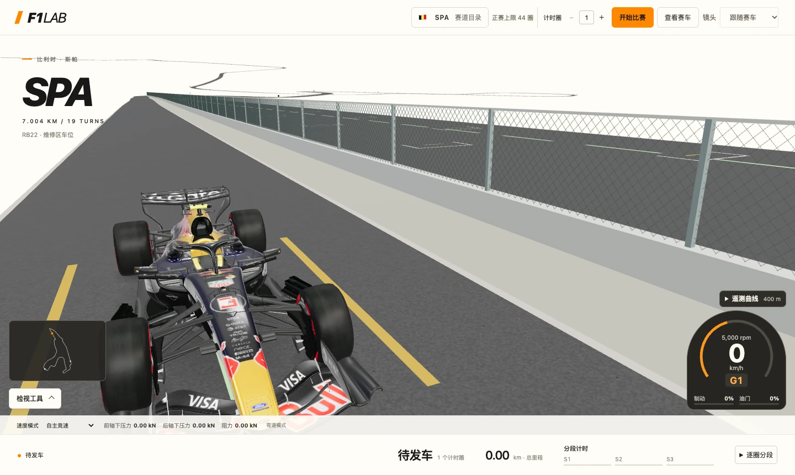

<div align="center">

# F1Lab

**浏览器端 F1 赛车动力学模拟器**

RB22 · Spa-Francorchamps · 自主驾驶与实时遥测

[模型与数据](#模型与数据)　·　[本地运行](#本地运行)　·　[模拟设计](#模拟设计)　·　[项目结构](#项目结构)

</div>



**Spa** 支持从维修区出发、完成计时圈并进站。可以从车顶镜头观察车手如何松刹、转向和开油，再用同一位置的遥测曲线和分段成绩复盘。**其余 23 站**支持发车格展示与赛道浏览。

## 模型与数据

| 资产 | 来源与用途 |
| --- | --- |
| RB22 赛车 | 原模型由 Tyler_Dave 制作，经 AgentiLoop/F1 引入。项目保留原涂装，拆分四轮和活动翼面，并重建轮轴以驱动转向和滚动动画。[原始模型](https://sketchfab.com/3d-models/2026-redbull-rb22-0a3d24a58e0549d591a5a48c22eec383) · [CC BY 4.0](https://creativecommons.org/licenses/by/4.0/) · [上游署名](data/models/rb22/UPSTREAM-CREDITS.md) |
| 赛道几何 | 24 站路带依据 Tomislav Bacinger 的中心线数据生成。Spa 以官方地图标高为基准，并结合历史遥测重建 Raidillon 的局部高差。路宽与路肩断面采用工程估值。[f1-circuits](https://github.com/bacinger/f1-circuits) · [赛道资料](docs/sources.md) |
| 驾驶与动力学 | OpenF1 比利时站历史遥测用于构建 Spa 参考线和速度曲线。轮胎、传动和空气动力学参数结合公开赛车资料估算。[OpenF1](https://openf1.org/) · [动力学参考资料](docs/vehicle-dynamics.md) |

项目用于个人非商业学习。各项资产的作者、许可和使用范围见[来源文档](docs/sources.md)。

## 本地运行

需要 Node.js 22.12 或更高版本，以及支持 WebGL 2 的浏览器。

```sh
git clone https://github.com/MichaelJLx/F1Lab_VibeCoding.git
cd F1Lab_VibeCoding
npm ci
npm run dev
```

打开终端显示的地址（默认 `http://127.0.0.1:5173`）。在 Spa 选择 **1 个计时圈** 并开始比赛，即可体验一次完整的出站、计时和进站流程。

## 模拟设计

| 驾驶环节 | 模拟器如何处理 |
| --- | --- |
| **入弯** | 车手按可用路宽比较候选线路，沿路线曲率和轮胎剩余抓地力反推制动点。连续弯按整组耗时评估。[驾驶与线路规划](src/motion/Cruise.ts) |
| **弯中与出弯** | 固定时间步长求解四轮接地力、悬架行程与车身横摆。驱动轮轮速和八速传动比决定 RPM，主动翼开度改变下压力和阻力。[车辆动力学](src/motion) |
| **冲线与下一圈** | 计时圈记录 S1、S2、S3 和总用时。Web Worker 计算下一圈方案，浏览器本地保存逐弯成绩与侧滑位置。[圈间规划](src/motion/lap.worker.ts) · [驾驶记忆](src/motion/DriverMemory.ts) |
| **观赛与复盘** | 各镜头共享实时仪表。展开遥测图可按距离对照最近 400 米的车速、油门和制动，计时圈结束后可回看指定弯段。[遥测图](src/ui/TelemetryPlot.tsx) · [弯段回放](src/ui/CornerReview.tsx) |

## 项目结构

应用使用 **TypeScript、React、Three.js 和 Vite**。`src/motion/` 推进车辆状态，`src/model/` 将状态映射到赛车模型，`src/ui/` 负责仪表、计时和赛后回看。

<details>
<summary><strong>展开目录树</strong></summary>

```text
F1Lab/
├── index.html                 浏览器入口
├── src/
│   ├── main.tsx               React 入口、赛道选择与比赛状态
│   ├── style.css              页面布局与转播界面样式
│   ├── motion/                车手控制、动力学、驾驶记忆与圈间规划
│   ├── optimizer/             参考线采样与行车线网格
│   ├── tracks/                赛道几何、路肩、弯号及运行时数据
│   ├── model/                 赛车装配、车轮与翼面动画、灯光
│   ├── camera/                自由镜头控制
│   └── ui/                    赛道目录、圈数选择、转播仪表与分段记录
├── public/
│   └── models/                浏览器加载的 GLB、灯光贴图与模型清单
├── data/
│   ├── models/                RB22 原始资产与署名
│   ├── tracks/                平面布局、高程样本与 Spa 遥测
│   └── vehicle-dynamics/      公开车辆参数、来源记录及上游许可
├── scripts/
│   ├── model/                 模型拆件、轮轴与翼面定位
│   └── tracks/                赛道重建、遥测配准与参考线生成
├── tests/                     模型校验、Spa 整圈与 Bus Stop 连续弯回归
├── docs/                      素材来源与动力学研究资料
├── package.json               npm 命令与依赖
├── tsconfig.json              TypeScript 配置
└── vite.config.ts             开发服务与生产构建配置
```

</details>

## 开发与验证

| 任务 | 仓库根目录命令 |
| --- | --- |
| 检查 TypeScript 类型 | `npm run typecheck` |
| 构建生产版本到 `dist/` | `npm run build` |
| 校验 GLB 结构、贴图与车轮轴心 | `npm test` |
| 运行 Spa 整圈回归 | `npm run test:spa` |
| 单独比较 Bus Stop 连续弯走线 | `npm run test:spa -- --bus-stop` |

更新原始赛车模型后，依次执行 `npm run model:build` 和 `npm run rig:build`。模型处理使用 glTF Transform，赛道数据处理使用 Node.js 和 Python。运行 Python 预处理脚本前，可在虚拟环境中执行 `python -m pip install -r scripts/requirements.txt`。

---

## 作者

**Michael** · 项目设计与驾驶体验　／　**OpenAI Codex** · 开发协作
