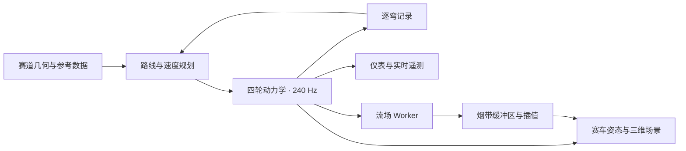

<div align="center">

# Formula one

**浏览器端方程式赛车动力学与遥测平台**

赛车检视 · 自主驾驶 · 走线寻优 · 空气动力学 · 实时遥测

[快速开始](#快速开始) · [功能与进度](#功能与进度) · [技术架构](#技术架构) · [项目结构](#项目结构) · [开发与验证](#开发与验证)

</div>

## 模型、开放数据与第三方署名

| 资源 | 作者与来源 | 项目用途及许可 |
| --- | --- | --- |
| **2026 Redbull RB22** | Dave Love（Tyler_Dave），[Sketchfab 原作](https://sketchfab.com/3d-models/2026-redbull-rb22-0a3d24a58e0549d591a5a48c22eec383) · [AgentiLoop/F1 上游版本](https://github.com/AgentiLoop/F1) | [CC BY 4.0](https://creativecommons.org/licenses/by/4.0/)。上游调整了金色紧固件贴图。Formula one 保留原涂装，烘焙模型变换，按 1.90 m 参考宽度缩放，并绑定车轮、主动翼与悬架。[修改与署名记录](data/models/rb22/UPSTREAM-CREDITS.md) · [模型清单](public/models/manifest.json) |
| 24 站平面布局 | Tomislav Bacinger，[f1-circuits](https://github.com/bacinger/f1-circuits) | 经纬度中心线用于生成缩略图、三维路带和发车格。[MIT](data/tracks/layouts/LICENSE-layout.md) |
| Spa 维修区中心线 | © OpenStreetMap contributors，[Pit Lane · way 323851541](https://www.openstreetmap.org/way/323851541) | 维修区道路的平面走向。[ODbL 1.0](https://www.openstreetmap.org/copyright) |
| 地形与高程 | [Mapzen Terrain Tiles](https://registry.opendata.aws/terrain-tiles/) · [Open Topo Data / EU-DEM](https://www.opentopodata.org/datasets/eudem/) | Mapzen 瓦片生成其余 23 站的纵坡；Spa 另存有 EU-DEM 25 m 采样。地形数据按地区保留原提供方署名。[Mapzen 数据提供方与使用条件](https://github.com/tilezen/joerd/blob/master/docs/attribution.md) |
| 翼面风洞压力 | Ladson、Hill 与 Johnson，NASA TM 100526 | NACA 0012 双面压力测点用于翼面 Cp 配色与吸力面烟流速度参考。[实验数据与验证说明](https://tmbwg.github.io/turbmodels/naca0012_val.html) |
| 比赛遥测 | [OpenF1](https://openf1.org/)，2024 年比利时大奖赛 | 佩雷兹第 44 圈用于配准路线、速度与 Raidillon 高差；20 位车手的 723 个绿旗有效圈用于节奏对照。[本地基准数据](data/tracks/spa/race-pace/benchmark.json) |
| 车辆动力学参考 | Juan Manzanero / Fastest-lap · TUM Institute of Automotive Technology | 历史 F1 拟合参数、通用赛车模型和轨迹优化配置。[Fastest-lap · MIT](data/vehicle-dynamics/fastest-lap_LICENSE) · [Open-Car-Dynamics · Apache-2.0](data/vehicle-dynamics/TUM_OCD_LICENSE) · [轨迹优化 · LGPL-3.0](data/vehicle-dynamics/TUM_trajectory_LICENSE) |

**赛事与技术文献**　FIA 赛道清单、分站赛事图、Spa 官方地图和赛事指南用于定位路宽、高程锚点、主动翼区间及刹车距离牌。Dallara F308 手册用于动力学查阅，开放再分发许可尚未核实。[逐项来源与赛道定位](docs/sources.md) · [动力学参考文献](docs/vehicle-dynamics.md)

**开源软件**

| 用途 | 项目与许可 |
| --- | --- |
| 页面与三维渲染 | React、React DOM、Three.js（MIT） |
| 开发与构建 | Vite、DefinitelyTyped 类型定义（MIT）；TypeScript（Apache-2.0） |
| 模型处理与校验 | glTF Transform、meshoptimizer（MIT）；Khronos glTF Validator（Apache-2.0） |
| 赛道与贴图处理 | NumPy、SciPy（BSD-3-Clause）；Pillow（HPND） |

前端依赖的锁定版本见 [package-lock.json](package-lock.json)，数据处理环境见 [Python 依赖清单](scripts/requirements.txt)。Formula one 用于个人学习与非商业演示，项目自身代码尚未指定开源许可证。

## 🏎️ 项目概览

Formula one 将赛车模型、赛道、驾驶策略和遥测放在同一个三维场景中。以 RB22 为车辆载体，围绕四轮动力学、连续弯走线选择与空力可视化构建可交互的驾驶研究环境。

界面采用白色与 Papaya 橙。顶栏集中赛道、视角与发车控制；底栏按能源与轮胎、驾驶与空力、视图辅助、圈速遥测分区。小地图、宽幅遥测和圆形码表组成底部 HUD，遥测与控制栏可分别收起。

<a id="快速开始"></a>
## ⚡ 快速开始

**环境：** Node.js `^20.19.0` 或 `>=22.12.0`，支持 WebGL 2 的浏览器。

```sh
git clone https://github.com/MichaelJLx/F1Lab_VibeCoding.git
cd F1Lab_VibeCoding
npm ci
npm run dev
```

打开终端显示的本地地址，默认 `http://127.0.0.1:5173`。车辆从维修区待发，在顶栏设置飞驰圈数并点击 **发车**。比赛可暂停、继续或重置；点击赛道名称打开目录。

首次进入会加载约 15 MB 的赛车模型及赛道数据。生产构建使用 `npm run build`，产物位于 `dist/`。

<a id="功能与进度"></a>
## 🧭 功能与进度

| 模块 | 当前能力 |
| --- | --- |
| **赛道浏览** | 24 站目录、三维路带与赛车检视；完整驾驶流程当前接入 Spa，其余赛道持续扩展 |
| **驾驶流程** | 维修区出站、1–44 个飞驰圈与进站；极限推进、稳健节奏及两档巡航 |
| **走线规划** | Spa 全部 19 弯按八组评估，联合比较入弯位置、弯心时机与出弯走线，以组合弯总用时筛选 |
| **跨圈调整** | 记录弯段成绩、侧滑与驾驶失误，为下一圈调整线路和制动策略；支持备选走线对照 |
| **车辆动力学** | 四轮载荷转移、独立悬架、滑移与横摆、循迹刹车、八速传动及主动翼联动 |
| **能源与轮胎** | ERS 部署和回收、轮胎磨损与抓地变化；两个消耗开关默认关闭，保持满电与满抓地力 |
| **空力展示** | 上游烟流、车身绕流、底板通道与尾流；独立 Cp 车身着色，关闭后恢复涂装，四轮保持原材质 |
| **实时遥测** | 最近 400 m 的车速／踏板、气动、底盘曲线；上一飞驰圈同位置对比、分段成绩与圈速榜 |
| **车内仪表** | 挡位、车速、圈速差、ERS、制动平衡、空力模式、四轮温度／胎压及实体 LED 换挡提示 |
| **观看与检视** | 头盔、车载、车尾、俯瞰、自由及赛道转播；部件标注、结构视图、车轮拆解与指定弯段回放 |

赛道几何由公开布局、高程和赛事资料重建；车辆动力学与部分局部路宽、横坡、路肩采用工程估值。Spa 展示官方长度 7.004 km，模拟里程按本地路带约 6.984 km 计算。数据依据见 [素材与赛道来源](docs/sources.md)、[动力学参考](docs/vehicle-dynamics.md)。

### 空气动力学

车辆受力模型根据车速、翼面开度、离地间隙与姿态计算下压力和阻力。烟流采用近似速度场及部件边界约束，翼面 Cp 以公开 NACA 0012 压力测点为参考。

- **流场计算：** Web Worker 推演完整路径，平滑处理部件绕流、翼尖涡流与扩散器尾流。
- **连续显示：** 平行传输标架生成烟带，GPU 复用缓冲区，对路径、流速和行程坐标同步插值；加载时预热完整流线。
- **车底约束：** 从模型生成下表面高度场，限制烟带处于地面与底板间隙内。
- **空力读数：** 前后轴分力及占比、阻力、L/D、主动翼模式和底板中段相对来流速度探针。

### 遥测与交互

| 区域 | 内容 |
| --- | --- |
| 顶栏 | 赛道目录、分段式视角切换、飞驰圈数、播放／暂停与重置 |
| 底部 HUD | 赛道小地图、可独立收起的宽幅遥测、圆形车速／油门／刹车码表 |
| 四区底栏 | ERS 与轮胎开关、四轮俯视状态、驾驶节奏、空力与视图辅助、S1／S2／S3 |
| 气动载荷 | 模式徽章、轴荷分配、阻力与效率标尺、流速及 Cp 色阶 |

遥测距离刻度使用独立 HTML 标尺，避免随波形缩放变形。窄屏下 HUD 分行排列，车载与头盔视角降低遥测透明度，控制栏独立预留画布空间。

<a id="技术架构"></a>
## 🛠️ 技术架构

| 层级 | 技术与职责 |
| --- | --- |
| 界面 | React 19、TypeScript、CSS、SVG；控制台、圆形仪表、遥测与状态图 |
| 三维 | Three.js、WebGL 2、GLSL；赛车装配、材质、镜头、烟流及压力着色 |
| 仿真 | TypeScript；以 1/240 s 固定步长推进车辆动力学 |
| 后台计算 | Web Workers；下一圈路线规划与气流路径求解 |
| 本地记录 | localStorage；逐弯成绩、侧滑位置与最近 60 圈计时历史 |
| 构建与数据 | Vite 7、Node.js、Python；模型处理、地形重建与参考数据生成 |



路线规划、车辆受力和可视化分别组织。`Cruise` 推进驾驶与计时，`Inspector` 管理场景和赛车装配，`CruiseSnapshot` 将车辆状态传递给界面。流场关闭时隐藏绘制并停止常规求解，缓冲区保留供再次开启使用。

<a id="项目结构"></a>
## 📁 项目结构

```text
.
├── index.html
├── src/
│   ├── main.tsx                 React 入口：赛道切换、圈数、比赛控制、四区底栏
│   ├── style.css                页面与转播界面样式
│   ├── motion/
│   │   ├── Cruise.ts            巡游状态机、走线选择、速度计划、计时与快照
│   │   ├── lap.worker.ts        下一圈规划的 Web Worker
│   │   ├── DriverMemory.ts      localStorage：弯道成绩、圈史与侧滑点
│   │   ├── Suspension.ts        四轮载荷、升沉/侧倾/俯仰
│   │   ├── LateralDynamics.ts   横向力、滑移与横摆
│   │   ├── AeroPlatform.ts      离地间隙、地面效应、翼面与阻力
│   │   ├── Tyre.ts              胎压、温度、磨损、锁死
│   │   ├── Gearbox.ts           八速传动、RPM 与驱动力
│   │   └── ActiveAero.ts        直道/弯道模式与翼面开度
│   ├── optimizer/RacingLine.ts  预计算行车线偏移与参考线网格
│   ├── tracks/
│   │   ├── SpaTrack.ts          Spa 路带、路肩、发车格、维修区装配
│   │   ├── StaticCircuit.ts     其余 23 站的静态路带
│   │   ├── PitLane.ts           维修区中心线、路面、围栏与车位
│   │   ├── BrakingBoards.ts     部分赛道的刹车距离牌
│   │   ├── SpaMarkers.ts        弯号牌与弯道站位
│   │   ├── catalog.json         24 站目录
│   │   ├── static-circuits.json 23 站路带点列
│   │   └── spa*.json            Spa 几何、路肩、维修区、参考线/速度/偏移
│   ├── model/
│   │   ├── Inspector.ts         Three.js 场景、赛车装配、镜头与检视
│   │   ├── ActiveWings.ts       前/后翼活动面拆分
│   │   ├── WheelEffects.ts      轮下接触阴影与运动残影
│   │   ├── TyreView.ts          胎面温度与磨损着色
│   │   ├── SuspensionLinks.ts   随车轮行程变形的悬架连杆
│   │   ├── SkidSparks.ts        底板火花
│   │   ├── MirrorGlare.ts       后视镜反光
│   │   ├── Airflow.ts           GPU 流带与缓冲区管理
│   │   ├── flow.worker.ts       独立流场计算线程
│   │   ├── FlowSolver.ts        绕流、涡流与尾流
│   │   ├── FlowBoundary.ts       部件距离查询与绕流边界
│   │   ├── FlowClearance.ts      车身下表面高度场
│   │   ├── RibbonFrame.ts        平行传输标架
│   │   ├── PressureMap.ts       Cp 车身压力视图
│   │   └── *.json               轮轴、翼面和底板探针等生成数据
│   ├── camera/FreeCamera.ts     自由视角
│   └── ui/                      选择赛道、圈数、转播条、遥测、过弯回放、分段历史
├── public/models/               rb22.glb、灯光贴图、manifest.json
├── data/
│   ├── models/rb22/             原始 GLB、上游署名与元数据
│   ├── tracks/                  布局 GeoJSON、地形、Spa 遥测/高程/PDF
│   └── vehicle-dynamics/        公开动力学参考原件（未接入运行参数）
├── scripts/
│   ├── model/                   模型清理、轮轴、翼面、悬架探针
│   └── tracks/                  赛道/遥测/参考线/地形构建
├── tests/                       模型、流场、能量回收与赛道回归
├── docs/                        素材来源、动力学资料
├── package.json
├── tsconfig.json
└── vite.config.ts
```

生成数据与原始资料分开管理：`data/` 保存来源，`scripts/` 维护构建过程，`src/` 和 `public/` 保存运行时使用的产物。

<a id="开发与验证"></a>
## 🧪 开发与验证

| 命令 | 用途 |
| --- | --- |
| `npm run dev` | 启动本地开发服务 |
| `npm run typecheck` | TypeScript 类型检查 |
| `npm run build` | 类型检查与生产构建 |
| `npm test` | 模型完整性、流场边界、标架连续性、Cp 材质与 ERS 回收回归 |
| `npm run test:spa` | Spa 整圈回归，默认 1 圈 |
| `SPA_LAPS=5 npm run test:spa` | 多圈驾驶与圈速回归 |
| `npm run test:spa -- --bus-stop` | Bus Stop 连续弯走线对比 |

整圈测试与可视化／模型单元测试分别运行。流场还需在浏览器中检查转向、起伏、主动翼切换和不同镜头下的画面。

<details>
<summary><strong>数据与模型构建管线</strong></summary>


`npm run dev` 和 `npm run build` 只消费已提交的生成数据。需要重建数据时，先安装 Python 依赖：

```sh
python3 -m pip install -r scripts/requirements.txt
```

脚本与产物的对应关系如下：

```text
scripts/tracks/fetch-spa-elevation.py    → data/tracks/spa/eudem25m.json
scripts/tracks/build-spa.mjs             → src/tracks/spa.json、data/tracks/spa/elevation-anchors.json
scripts/tracks/fetch-circuit-terrain.py  → data/tracks/terrain/terrain.json
scripts/tracks/build-track-catalog.py    → src/tracks/catalog.json
scripts/tracks/build-static-circuits.py  → src/tracks/static-circuits.json
scripts/tracks/build-race-path.py        → src/tracks/spa-race-path.json、src/tracks/spa-flying-speed.json、data/tracks/spa/raidillon-profile.json
scripts/tracks/build-fast-line.py        → src/tracks/spa-fast-line.json
scripts/tracks/build-race-speed.py       → src/tracks/spa-race-speed.json
scripts/tracks/build-pace-benchmark.py   → data/tracks/spa/race-pace/benchmark.json
scripts/tracks/build-racing-line.mjs     → src/tracks/spa-racing-line.json（也可 npm run line:build）
scripts/model/prepare-model.mjs          → public/models/rb22.glb、public/models/manifest.json（也可 npm run model:build）
scripts/model/build-plan-view.mjs        → src/model/rb22-plan-view.json（俯视轮廓）
scripts/model/build-wheel-rig.mjs        → src/model/wheel-rig.json（也可 npm run rig:build）
scripts/model/build-suspension-rig.mjs   → src/model/suspension-rig.json（底板探针与悬架连杆）
scripts/model/build-wing-rig.py          → src/model/flap-ranges.json
```

除标注了 npm 命令的脚本外，其余脚本没有 npm 包装，需要按依赖顺序手动运行。其中 `build-race-path.py` 读取 `data/tracks/spa/flying/`，`build-pace-benchmark.py` 读取 `data/tracks/spa/race-pace/`。

更新原始赛车模型时，将新 GLB 放到 `data/models/rb22/rb22-community.glb`，再依次执行 `npm run model:build`、`npm run rig:build`、`node scripts/model/build-suspension-rig.mjs`（重建底板探针与悬架连杆）和 `python3 scripts/model/build-wing-rig.py`（重建翼面分片），最后运行 `node scripts/model/build-plan-view.mjs` 同步俯视状态图。

模型处理使用 glTF Transform、meshoptimizer 和 glTF Validator；赛道处理使用 Node.js 与 Python。

</details>

## 作者

**Michael** · 项目设计与驾驶体验<br>
**OpenAI Codex** · 开发协作
